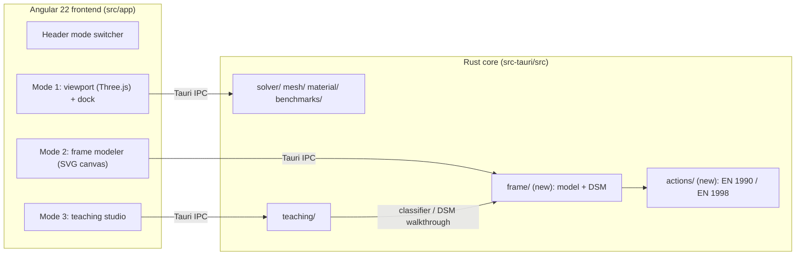

# OmniMechanics: Application Architecture Summary (Synthesis)

- Status: **draft for user review** (application synthesis gate, 2026-10-31)
- Product truth: [docs/prd.md](../prd.md). Planning map: [`.okf/`](../../.okf/index.md)

## 1. Runtime topology

- **Frontend:** Angular 22, standalone components, OnPush, signals and Signal Forms. Three.js for the
  Mode 1 viewport, SVG for 2D structural canvases, KaTeX for equations.
- **Backend:** Rust (Tauri 2) with `faer` (sparse/dense linear algebra, rayon), `nalgebra`, `serde`.
- **IPC:** Tauri commands with serde DTOs. Existing commands include the Mode 1 solver commands and
  `solve_teaching_system`.

## 2. Boundaries and ownership

| Boundary | Owner capability | Code home | Notes |
| --- | --- | --- | --- |
| Continuum solvers | cap-solver-core, cap-material-field, cap-geometry-presets | `solver/`, `material/`, `mesh/` | Unchanged |
| Structural model + DSM analyses | cap-frame-analysis-engine | `src-tauri/src/frame/` (new) | **Single owner** of nodes, members, sections, supports, loads, load cases, masses |
| Actions, combinations, spectra | cap-eurocode-actions-combinations | `src-tauri/src/actions/` (new) | Pure normative logic. Produces combination definitions and spectra, never solves |
| Mode 2 workspace | cap-sketcher-frame-modeler | `src/app/features/modeler/` (new) | Edits the model through a frontend model store. Holds no analysis logic |
| Classical teaching methods | cap-structural-mechanics-teaching | `src-tauri/src/teaching/`, `src/app/features/teaching/` | Gains a classifier that reads the shared frame model |
| RC design | cap-eurocode-rc-design | (future) | Consumes envelopes from the frame engine |
| Persistence | cap-project-persistence | (future) | JSON project schema including the frame model, load cases, and combinations |

Dependency direction (enforced): `modeler UI → frame engine → actions`, `teaching → frame engine`,
`rc-design → frame engine + actions`. The frame engine never depends on teaching or UI.

## 3. Cross-capability contracts (specified)

Detailed transport-neutral and Tauri IPC contracts live in the capability specification directories (`docs/architecture/<capability-slug>/canonical-api-cli-contract.md`):
- [cap-frame-analysis-engine contract](cap-frame-analysis-engine/canonical-api-cli-contract.md) (`frame_*` IPC commands, `analysis://progress` events)
- [cap-eurocode-actions-combinations contract](cap-eurocode-actions-combinations/canonical-api-cli-contract.md) (`actions_*` IPC commands)
- [cap-sketcher-frame-modeler contract](cap-sketcher-frame-modeler/canonical-api-cli-contract.md) (Mode 2 store, snapping engine, IPC bindings)
- [cap-sketcher-continuum-domain contract](cap-sketcher-continuum-domain/canonical-api-cli-contract.md) (`continuum_*` CDT meshing IPC commands)
- [cap-interactive-canvas contract](cap-interactive-canvas/canonical-api-cli-contract.md) (Tri-mode shell, 3D viewport, shared 2D SVG kernel)
- [cap-project-persistence contract](cap-project-persistence/canonical-api-cli-contract.md) (`project_*` `.bem` persistence and SVG/PNG export commands)

Key cross-capability surfaces:
- **Frame model DTO (`StructuralModel`):** a serde-serialisable model shared by Mode 2, Mode 3 (classifier), and persistence.
  It replaces the retired `SketchModel` from issue 015 and the ad-hoc teaching inputs for sketches.
- **Analysis request/response:** the model plus the analysis kind (linear, P-Δ, buckling, modal, RSA,
  lateral force) plus the case/combination selection. The response carries reactions, displacements,
  member diagrams sampled analytically, end forces, extrema, envelopes with governing combinations, and
  diagnostics (mechanism mode, indeterminacy degree).
- **Background jobs:** nonlinear and dynamic analyses run as cancellable jobs with progress events. A new
  model revision cancels stale jobs. Linear solves are synchronous.
- **Classifier contract:** model → list of eligible classical methods with reasons, plus DSM walkthrough
  step data.
- **Combination contract:** tagged load cases plus NA parameters → generated and user-edited
  combinations (factors per case). Seismic parameters → design spectrum.

## 4. Shared policies

- Units, signs, language, and superposition rules: see PRD §6.
- **Performance:** linear < 50 ms for ~500 nodes / 1000 members. Nonlinear < 2 s per combination.
  Live re-solve with ~150 ms debounce.
- **Code standards:** Rust/TS ≤ 1000 lines, HTML ≤ 500 lines, tests in companion `*_test.rs` files,
  pre-commit limits hook.
- **Numerical verification:** closed-form tolerances 1e-6 (linear) and 1e-3 (nonlinear). OpenSeesPy
  references are generated offline and committed. No runtime dependency on OpenSees.

## 5. Sequencing

1. Spec pipeline: `cap-frame-analysis-engine` (model + linear DSM contract first), then
   `cap-sketcher-frame-modeler`.
2. Mode 2 slice 1 (linear live), with the Vitest harness introduced in the same slice.
3. `cap-eurocode-actions-combinations` spec, then slice 2.
4. Teaching PRD refresh (classifier), then slice 3.
5. Nonlinear (P-Δ/buckling, cables), then dynamics/seismic.

## 6. Verification strategy

| Surface | Mode | Harness |
| --- | --- | --- |
| backend-boundary | required | `cargo test` (companion test files, reference suites) |
| frontend-integration | required | Vitest (to be introduced in Mode 2 slice 1) |
| end-to-end | catalog-only | Visual review gate per UI issue |

## 7. Known risks

- Real-time behaviour with nonlinear solvers is mitigated by the linear-first, background-replace
  strategy.
- Scope breadth (catenary, P-Δ, RSA, full EN 1990/1998) is mitigated by strict slice ordering, with each
  slice delivering a visible Mode 2 result.
- Divergent model definitions between teaching and frame engines are mitigated by the single model
  owner and a teaching adapter.
