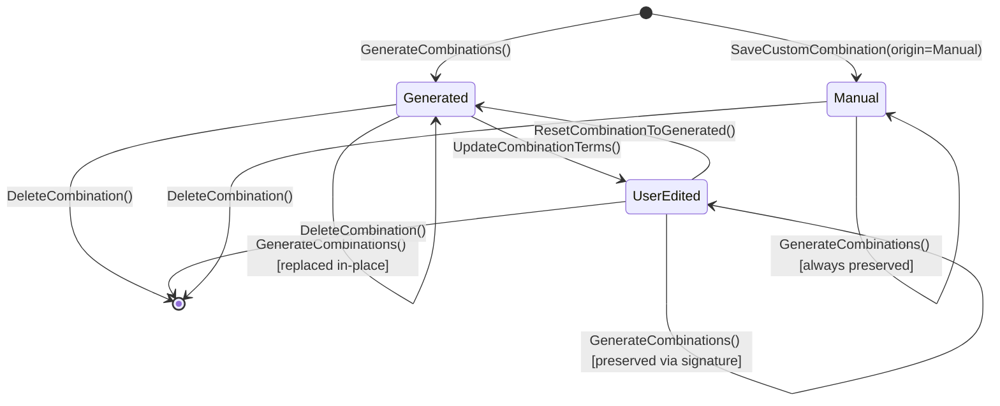

# Canonical Domain Model: Eurocode Actions, Load Combinations & Seismic Loading (`cap-eurocode-actions-combinations`)

- **Owning capability:** [`cap-eurocode-actions-combinations`](../../../.okf/capabilities/cap-eurocode-actions-combinations.md)
- **Cross-capability conventions:** [`cross-capability-conventions.md`](../cross-capability-conventions.md)
- **Glossary:** [`domain-glossary.md`](domain-glossary.md)
- **PRD:** [`prd.md`](prd.md)
- **Status:** Canonical Domain Model (2026-11-01)

---

## 1. Purpose & Modeling Principles

This document defines the canonical domain model for `cap-eurocode-actions-combinations`. It captures the exact business aggregates, value objects, enumerations, normative services, and invariants required to classify load cases into Eurocode actions, generate EN 1990 ULS/SLS/Seismic combinations, and define EN 1998-1 seismic spectra and lateral force rules.

### Modeling Principles
1. **Pure Normative Boundary:** The domain model contains zero finite-element stiffness matrices, zero mesh/node topology, and zero reinforcement detailing logic. It deals exclusively in `ActionType` classifications, normative factors ($\gamma, \xi, \psi$), `Combination` recipes, and `DesignSpectrum` curves.
2. **Deterministic Value Semantics:** Normative factor lookup, combination permutation expansion, and spectrum evaluation are pure, deterministic functions of `NationalAnnexProfile`, `SeismicSettings`, and `LoadCaseDescriptor` inputs.
3. **Provenance Preservation:** User customizations to generated combinations (`UserEdited`) and custom combinations (`Manual`) are protected across automatic regenerations by explicit lifecycle rules.

---

## 2. Subdomains & Bounded Context Seam

Within OmniMechanics, `cap-eurocode-actions-combinations` (`src-tauri/src/actions/`) acts as a shared normative kernel consumed by:
- **`cap-frame-analysis-engine` (`src-tauri/src/frame/`):** Passes `LoadCaseDescriptor` lists to generate combinations, evaluates `SeismicMassCombinationRule` to assemble the modal mass matrix $\mathbf{M}$, queries `DesignSpectrum` ordinates $S_d(T_k)$ for modal RSA or `ComputeLateralForceDistribution` for equivalent static seismic analysis, and computes `Envelope` extrema over `EnvelopeSpecification` groups.
- **`cap-eurocode-rc-design`:** Reads `LimitState`-tagged `Envelope` outputs (`ULS_STR`, `SEISMIC`, `SLS_CHAR`, `SLS_FREQ`, `SLS_QP`) alongside partial safety factors.
- **`cap-sketcher-frame-modeler`:** Displays and edits the `NationalAnnexProfile`, `CombinationSet`, and `SeismicSettings` in Mode 2 dialogs and inspector panels.

```mermaid
classDiagram
  class NationalAnnexProfile {
    +String code
    +BilingualText name
    +UlsEquationPolicy uls_equation_policy
    +PermanentActionFavorabilityPolicy permanent_favorability_policy
    +PartialSafetyFactors gamma
    +Map~ActionCategoryKey, PsiFactors~ psi_table
  }
  class CombinationSet {
    +u64 revision
    +Vec~Combination~ combinations
    +Vec~EnvelopeSpecification~ envelopes
  }
  class Combination {
    +String id
    +String code
    +BilingualText name
    +LimitState limit_state
    +CombinationOrigin origin
    +Option~CombinationEquation~ equation
    +Vec~CombinationTerm~ terms
    +BilingualText symbolic_formula
  }
  classismicSettings {
    +SeismicZone zone
    +f64 ag_reference_g
    +GroundType ground_type
    +ImportanceClass importance_class
    +f64 gamma_i
    +StructuralSystemGuidance system_guidance
    +f64 behavior_factor_q
    +f64 damping_ratio_percent
    +ModalCombinationRule modal_combination_rule
    +bool include_vertical_component
    +f64 vertical_behavior_factor_qv
    +f64 psi_e_phi
  }
  class DesignSpectrum {
    +f64 ag_m_s2
    +f64 soil_factor_s
    +f64 tb_s
    +f64 tc_s
    +f64 td_s
    +f64 beta_lower_bound
    +Vec~SpectrumPoint~ horizontal_points
    +Option~Vec~SpectrumPoint~~ vertical_points
  }
  CombinationSet "1" *-- "*" Combination
  NationalAnnexProfile ..> CombinationSet : generates
  SeismicSettings ..> DesignSpectrum : computes
```

---

## 3. Enumerations & Status Vocabularies

### 3.1 `ActionType` and `ImposedCategory`
```rust
pub enum ImposedCategory {
    A, // Domestic / residential areas
    B, // Office areas
    C, // Congregation areas
    D, // Shopping areas
    E, // Storage areas
    F, // Traffic area, vehicle weight <= 30 kN
    G, // Traffic area, 30 kN < vehicle weight <= 160 kN
    H, // Roofs (inaccessible except normal maintenance)
}

pub enum ActionType {
    Permanent,
    Imposed { category: ImposedCategory },
    Snow,
    Wind,
    Temperature,
    Seismic,
    Accidental, // Reserved; rejected by combination generator in current scope
}
```

### 3.2 `LimitState`, `CombinationOrigin`, `CombinationEquation`, and `CombinationRole`
```rust
pub enum LimitState {
    ULS_STR,
    ULS_GEO,
    SLS_CHAR,
    SLS_FREQ,
    SLS_QP,
    SEISMIC,
}

pub enum CombinationOrigin {
    Generated,
    UserEdited,
    Manual,
}

pub enum CombinationEquation {
    Eq6_10,
    Eq6_10a,
    Eq6_10b,
    Eq6_12b,
    Eq6_14b,
    Eq6_15b,
    Eq6_16b,
    Custom,
}

pub enum CombinationRole {
    PermanentUnfavorable,
    PermanentFavorable,
    LeadingVariable,
    AccompanyingVariable,
    SeismicPrimary,
    SeismicAccompanying,
    ManualFactor,
}
```

### 3.3 Policies & Seismic Enumerations
- **`UlsEquationPolicy`:** `Single6_10` (default for `GR`) | `Twin6_10a_6_10b`.
- **`PermanentActionFavorabilityPolicy`:** `BothBranches` (default: emits both $1.35 G$ and $1.00 G$ combinations) | `UnfavorableOnly` ($1.35 G$ only) | `PerCasePermutation` ($2^m$ combinations for $m \le 6$ permanent cases).
- **`SeismicZone`:** `ZoneI` ($0.16g$) | `ZoneII` ($0.24g$) | `ZoneIII` ($0.36g$) | `Custom`.
- **`GroundType`:** `A` | `B` | `C` | `D` | `E` | `Custom`.
- **`ImportanceClass`:** `ClassI` ($\gamma_I = 0.80$) | `ClassII` ($\gamma_I = 1.00$) | `ClassIII` ($\gamma_I = 1.20$) | `ClassIV` ($\gamma_I = 1.40$) | `Custom`.
- **`ModalCombinationRule`:** `SRSS` | `CQC`.
- **`StructuralSystemGuidance`:** `RcMomentFrameDcm` ($q=3.90$) | `RcDualSystemDcm` ($q=3.60$) | `RcDuctileWallDcm` ($q=3.00$) | `RcInvertedPendulumDcm` ($q=1.50$) | `LowDuctilityDcl` ($q=1.50$) | `SteelMomentFrameDcm` ($q=4.00$) | `SteelConcentricBracedDcm` ($q=4.00$) | `Custom`.

---

## 4. Aggregates, Entities & Value Objects

### 4.1 Aggregate Root: `NationalAnnexProfile`
Protects the consistency of Eurocode 0 partial factors and $\psi$ coefficients.
- **Attributes:**
  - `code: String` (`"GR"` default, or `"CUSTOM"` when overridden).
  - `name: BilingualText` (`el`: `"Ελληνικό Εθνικό Προσάρτημα (ΕΛΟΤ EN 1990/1998)"`, `en`: `"Greek National Annex (ELOT EN 1990/1998)"`).
  - `uls_equation_policy: UlsEquationPolicy` (default `Single6_10`).
  - `permanent_favorability_policy: PermanentActionFavorabilityPolicy` (default `BothBranches`).
  - `gamma_g_sup: f64` (default `1.35`), `gamma_g_inf: f64` (default `1.00`).
  - `gamma_q_sup: f64` (default `1.50`), `gamma_q_inf: f64` (default `0.00`).
  - `xi_reduction: f64` (default `0.85`).
  - `psi_factors: Map<ActionCategoryKey, PsiFactors>` where `PsiFactors = { psi_0: f64, psi_1: f64, psi_2: f64 }`.

### 4.2 Aggregate Root: `CombinationSet` & Entity `Combination`
Owns the project's collection of load combinations and envelope definitions.
- **`Combination` Entity:**
  - `id: String` (stable ID: `"CO1"`, `"CO2"`, ...).
  - `name: BilingualText` (human-readable name, e.g., `"ULS STR - Leading Q1 (Unfavorable G)"`).
  - `limit_state: LimitState`.
  - `origin: CombinationOrigin`.
  - `equation: Option<CombinationEquation>`.
  - `leading_load_case_id: Option<String>`.
  - `terms: Vec<CombinationTerm>` where each `CombinationTerm` holds `{ load_case_id: String, factor: f64, role: CombinationRole }`.
  - `symbolic_formula: BilingualText` (e.g., `"1.35·G1 + 1.50·Q1 + 0.90·W1"`).
  - `generation_signature: Option<String>` (canonical key identifying the generated slot, e.g., `"ULS_STR:Eq6_10:G_SUP:LEAD_LC2"`, so regenerated combinations preserve stable `CO#` IDs when possible).
- **`EnvelopeSpecification` Value Object:**
  - `id: String` (`"ENV_ULS_STR"`, `"ENV_SEISMIC"`, `"ENV_SLS_CHAR"`, `"ENV_SLS_FREQ"`, `"ENV_SLS_QP"`, `"ENV_ULS_ALL"`).
  - `name: BilingualText`.
  - `limit_state: LimitState`.
  - `combination_ids: Vec<String>` (non-empty list of included `Combination` IDs).

### 4.3 Aggregate Root: `SeismicSettings` & Value Object `DesignSpectrum`
Owns the EN 1998-1 seismic configuration and derives the response spectrum curves.
- **`SeismicSettings` Attributes:**
  - `zone: SeismicZone` (default `ZoneI`), `ag_reference_g: f64` (default `0.16`).
  - `ground_type: GroundType` (default `B`), `soil_factor_s: f64` (`1.20`), `tb_s: f64` (`0.15`), `tc_s: f64` (`0.50`), `td_s: f64` (`2.00`).
  - `importance_class: ImportanceClass` (default `ClassII`), `gamma_i: f64` (`1.00`).
  - `system_guidance: StructuralSystemGuidance` (default `RcMomentFrameDcm`), `behavior_factor_q: f64` (`3.90`).
  - `damping_ratio_percent: f64` (default `5.0`).
  - `beta_lower_bound: f64` (default `0.20`).
  - `modal_combination_rule: ModalCombinationRule` (default `CQC`).
  - `include_vertical_component: bool` (default `false`), `vertical_behavior_factor_qv: f64` (default `1.50`).
  - `psi_e_phi: f64` (default `1.00`).
- **`DesignSpectrum` Value Object:**
  - `ag_m_s2: f64`, `avg_m_s2: Option<f64>`, `eta_damping: f64`.
  - `soil_factor_s: f64`, `tb_s: f64`, `tc_s: f64`, `td_s: f64`, `beta_lower_bound: f64`.
  - `horizontal_curve: Vec<SpectrumPoint>` where `SpectrumPoint = { period_s: f64, se_m_s2: f64, sd_m_s2: f64, se_g: f64, sd_g: f64 }`.
  - `vertical_curve: Option<Vec<SpectrumPoint>>`.

---

## 5. Domain Services

1. **`CombinationGeneratorService`:**
   - Input: `Vec<LoadCaseDescriptor>`, `NationalAnnexProfile`, `Option<SeismicSettings>`, existing `Vec<Combination>`.
   - Behavior: Validates all `LoadCaseDescriptor` entries, expands ULS (`ULS_STR`, optional `ULS_GEO`), SLS (`SLS_CHAR`, `SLS_FREQ`, `SLS_QP`), and `SEISMIC` permutations, matches `generation_signature` against existing `UserEdited` combinations (skipping overwriting them), retains all `Manual` combinations, removes references to deleted load cases, and builds `EnvelopeSpecification` sets.
2. **`SpectrumCalculatorService`:**
   - Input: `SeismicSettings`, sample period grid (default 201 points from $T = 0.0\text{ s}$ to $4.0\text{ s}$ Always including exact corner periods $0, T_B, T_C, T_D, 4.0$) plus any caller-requested modal periods $T_k$.
   - Behavior: Evaluates $S_e(T)$ and $S_d(T)$ horizontally and (if enabled) vertically, returning `DesignSpectrum`.
3. **`SeismicMassAndLateralForceService`:**
   - **Mass Rule:** Maps `Vec<LoadCaseDescriptor>` + `NationalAnnexProfile` + `SeismicSettings` to `SeismicMassCombinationRule` containing `{ load_case_id, factor, role }` where `Permanent` gets `1.0` and variable cases get $\psi_{E,i} = \varphi \cdot \psi_{2,i}$.
   - **Lateral Force Distribution:** Given `t1_s: f64`, `n_storeys: u32`, `levels: Vec<MassLevelInput>` (`{ id, height_z_m, mass_t }`), and `SeismicSettings`, computes $S_d(T_1)$, $\lambda \in \{0.85, 1.00\}$, base shear $F_b = S_d(T_1) \cdot m_{\text{total}} \cdot \lambda$, and level horizontal forces $F_i = F_b \frac{z_i m_i}{\sum z_j m_j}$.
   - **CQC Correlation Matrix:** Given modal periods `periods_s: Vec<f64>` and `damping_ratio_percent: f64`, returns the symmetric $k \times k$ matrix $\rho_{ij} \in [0, 1]$.

---

## 6. Domain Invariants & Lifecycle Rules

### 6.1 Hard Invariants
- **INV-ACT-01 (Factor Bounds):** In `NationalAnnexProfile`, $\gamma_{G,\text{sup}} \ge \gamma_{G,\text{inf}} \ge 0$, $\gamma_{Q,\text{sup}} > 0$, $\gamma_{Q,\text{inf}} \ge 0$, $\xi \in (0.0, 1.0]$, and for every category $1.0 \ge \psi_0 \ge \psi_1 \ge \psi_2 \ge 0.0$.
- **INV-ACT-02 (At Least One Permanent Case for ULS/SLS Generation):** `GenerateCombinations` requires at least one `LoadCaseDescriptor` tagged `ActionType::Permanent`.
- **INV-ACT-03 (Reserved Accidental Rejection):** Tagging a load case as `ActionType::Accidental` and invoking combination generation raises `ACTIONS_ACCIDENTAL_NOT_SUPPORTED`.
- **INV-ACT-04 (Per-Case Permutation Cap):** `PermanentActionFavorabilityPolicy::PerCasePermutation` is rejected with `ACTIONS_TOO_MANY_PERMANENT_CASES` if the number of `Permanent` load cases exceeds $6$ ($2^6 = 64$ branches).
- **INV-ACT-05 (Seismic Parameter Validity):** $a_{gR}/g \in (0.0, 2.0]$, $\gamma_I \in [0.5, 3.0]$, $S \in [0.5, 3.0]$, $0 < T_B < T_C < T_D \le 10.0\text{ s}$, $q \in [1.0, 10.0]$, $q_v \in [1.0, 3.0]$, $\zeta \in [0.0, 30.0]\%$, $\beta \in [0.05, 0.50]$, and $\varphi \in (0.0, 1.0]$.
- **INV-ACT-06 (Non-Empty Combination Terms):** Every `Combination` must contain at least one `CombinationTerm` with a finite non-zero `factor`, and all referenced `load_case_id` values must exist in the active `LoadCaseDescriptor` list.
- **INV-ACT-07 (Lateral Force Level Validity):** In `ComputeLateralForceDistribution`, $T_1 \ge 0.0\text{ s}$, all masses $m_i \ge 0$ with $\sum m_i > 0$, and at least one level has $z_i > 0\text{ m}$ so $\sum z_j m_j > 0$.

### 6.2 Combination Lifecycle State Machine


---

## 7. Domain Events & Cross-Aggregate Consistency

When mutated inside a project workspace (`StructuralModel` or `ProjectDocument`), changes to `NationalAnnexProfile`, `CombinationSet`, or `SeismicSettings` increment the model/workspace `revision`, emitting:
- `NationalAnnexUpdated { revision }`
- `CombinationsRegenerated { revision, generated_count, preserved_count }`
- `CombinationEdited { revision, combination_id, origin }`
- `SeismicSettingsUpdated { revision, ag_m_s2, sd_plateau_m_s2 }`

Any revision increment invalidates cached `Envelope` and `ResultSet` objects in `cap-frame-analysis-engine` for combinations whose terms changed.
