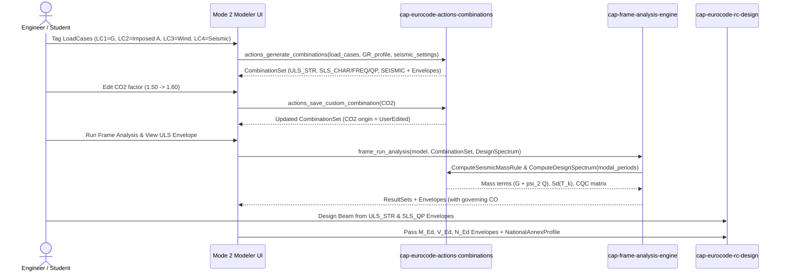

# Canonical Use-Case & Application-Service Model: Eurocode Actions, Load Combinations & Seismic Loading (`cap-eurocode-actions-combinations`)

- **Owning capability:** [`cap-eurocode-actions-combinations`](../../../.okf/capabilities/cap-eurocode-actions-combinations.md)
- **Cross-capability conventions:** [`cross-capability-conventions.md`](../cross-capability-conventions.md)
- **Glossary:** [`domain-glossary.md`](domain-glossary.md)
- **PRD:** [`prd.md`](prd.md)
- **Domain Model:** [`canonical-domain-model.md`](canonical-domain-model.md)
- **Status:** Canonical Use-Case Model (2026-11-01)

---

## 1. Purpose & Application-Layer Goals

This document defines the canonical application-layer commands, queries, orchestration services, transaction boundaries, and failure semantics for `cap-eurocode-actions-combinations`. It sits between the domain model (`src-tauri/src/actions/`) and external interfaces (Tauri IPC commands prefixed `actions_` and internal Rust calls from `cap-frame-analysis-engine` and `cap-eurocode-rc-design`).

### Application-Layer Design Principles
1. **Stateless Pure Normative Execution + Workspace State Synchronization:** Every normative computation (`GenerateCombinations`, `ComputeDesignSpectrum`, `ComputeSeismicMassRule`, `ComputeLateralForceDistribution`) can be invoked either as a pure deterministic function on supplied DTOs or against the active workspace project state.
2. **Explicit Provenance Protection:** Application commands that regenerate combinations never overwrite `UserEdited` or `Manual` entries unless the caller explicitly requests `reset_user_edited: true`.
3. **Bilingual Explainability by Default:** All responses include bilingual (`el`, `en`) labels, symbolic combination formulas, and Eurocode clause citations so Mode 2 and Mode 3 UIs never hardcode normative formulas.

---

## 2. Application Service Groupings

| Application Service | Responsibility | Consumers |
| --- | --- | --- |
| **`NationalAnnexApplicationService`** | Retrieves default Greek NA (`GR`) profiles, validates custom $\gamma/\xi/\psi$ overrides, and returns structural system $q$-factor guidance catalogs. | Mode 2 UI, `CombinationApplicationService` |
| **`CombinationApplicationService`** | Generates EN 1990 (`ULS_STR`, `ULS_GEO`, `SLS_CHAR`, `SLS_FREQ`, `SLS_QP`) and EN 1998 (`SEISMIC`) combinations, handles user edits (`Generated` $\to$ `UserEdited`), creates `Manual` combinations, deletes/resets combinations, and computes `EnvelopeSpecification` sets. | Mode 2 UI, `cap-frame-analysis-engine`, `cap-eurocode-rc-design` |
| **`SeismicActionApplicationService`** | Validates `SeismicSettings`, computes `DesignSpectrum` curves ($S_e(T), S_d(T)$ horizontal & vertical), evaluates ordinates at arbitrary modal periods $T_k$, derives `SeismicMassCombinationRule` ($G + \psi_{E,i} Q$), computes EN 1998-1 lateral force distributions ($F_b, F_i$), and evaluates CQC modal correlation matrices $\rho_{ij}$. | Mode 2 UI, `cap-frame-analysis-engine` |

---

## 3. Canonical Commands & Queries

### 3.1 `NationalAnnexApplicationService`

#### Query `GetDefaultNationalAnnexProfile`
- **Intent:** Retrieve the canonical Greek National Annex (`GR`) profile along with the catalog of `ActionType` metadata and `StructuralSystemGuidance` presets.
- **Input:** `{ code?: String }` (defaults to `"GR"`).
- **Output:** `{ profile: NationalAnnexProfile, action_catalog: Vec<ActionCategoryMetadata>, system_guidance_catalog: Vec<StructuralSystemGuidanceEntry> }`.
- **Failures:** `ACTIONS_UNKNOWN_NA_CODE` if `code` is not `"GR"`.

#### Command `ValidateAndApplyNationalAnnexProfile`
- **Intent:** Validate a modified `NationalAnnexProfile` (checking $\gamma, \xi, \psi$ invariants) and optionally trigger combination regeneration.
- **Input:** `{ profile: NationalAnnexProfile, load_cases?: Vec<LoadCaseDescriptor>, existing_combinations?: Vec<Combination>, seismic_settings?: SeismicSettings }`.
- **Preconditions:** **INV-ACT-01** ($\gamma_{G,\text{sup}} \ge \gamma_{G,\text{inf}} \ge 0$, $1 \ge \psi_0 \ge \psi_1 \ge \psi_2 \ge 0$, $\xi \in (0, 1]$).
- **Output:** `{ profile: NationalAnnexProfile, combination_set?: CombinationSet }`.
- **Failures:** `ACTIONS_INVALID_GAMMA_FACTOR`, `ACTIONS_INVALID_PSI_FACTOR`, `ACTIONS_INVALID_XI_FACTOR`.

---

### 3.2 `CombinationApplicationService`

#### Command `GenerateCombinations`
- **Intent:** Expand a list of tagged `LoadCaseDescriptor` entries into the complete normative `CombinationSet` (combinations + `EnvelopeSpecification` groups) while preserving `UserEdited` and `Manual` combinations.
- **Input:**
  - `load_cases: Vec<LoadCaseDescriptor>` (`id`, `code`, `name`, `action_type`)
  - `profile: NationalAnnexProfile`
  - `seismic_settings?: Option<SeismicSettings>`
  - `existing_combinations: Vec<Combination>`
  - `include_uls_geo: bool` (default `false`)
  - `reset_user_edited: bool` (default `false`)
- **Preconditions:**
  - At least one `LoadCaseDescriptor` has `ActionType::Permanent` (**INV-ACT-02**).
  - No `LoadCaseDescriptor` has `ActionType::Accidental` (**INV-ACT-03**).
  - If `profile.permanent_favorability_policy == PerCasePermutation`, count of `Permanent` cases $\le 6$ (**INV-ACT-04**).
- **Application Responsibilities:**
  1. Validate `profile` and `load_cases` (check unique `id`s).
  2. Prune any terms in `existing_combinations` referencing deleted `load_case_id`s; if a `UserEdited` or `Manual` combination loses all terms, drop it and record a warning.
  3. Generate deterministic permutations for `ULS_STR`, optional `ULS_GEO`, `SLS_CHAR`, `SLS_FREQ`, `SLS_QP`, and (when `ActionType::Seismic` load cases exist) `SEISMIC`.
  4. If `reset_user_edited == false`, keep any existing `UserEdited` combination whose `generation_signature` matches a generated slot instead of replacing it.
  5. Append all surviving `Manual` combinations.
  6. Assign stable `CO1..COn` identifiers, build bilingual symbolic formulas, and assemble `EnvelopeSpecification` groups per `LimitState`.
- **Output:** `CombinationSet { revision, combinations: Vec<Combination>, envelopes: Vec<EnvelopeSpecification>, warnings: Vec<BilingualText> }`.
- **Failures:** `ACTIONS_NO_PERMANENT_LOAD_CASE`, `ACTIONS_ACCIDENTAL_NOT_SUPPORTED`, `ACTIONS_TOO_MANY_PERMANENT_CASES`, `ACTIONS_DUPLICATE_LOAD_CASE_ID`.

#### Command `SaveCustomCombination`
- **Intent:** Update an existing combination (promoting `Generated` $\to$ `UserEdited`) or create a new `Manual` combination, and recompute `EnvelopeSpecification` memberships.
- **Input:**
  - `combination: CombinationDraft` (`id?: Option<String>`, `name: BilingualText`, `limit_state: LimitState`, `terms: Vec<CombinationTerm>`)
  - `load_cases: Vec<LoadCaseDescriptor>`
  - `existing_combinations: Vec<Combination>`
- **Preconditions:** **INV-ACT-06** (non-empty `terms`, finite non-zero factors, all `load_case_id` values exist in `load_cases`).
- **Application Responsibilities:**
  1. If `combination.id` matches an existing `Generated` combination, set `origin = CombinationOrigin::UserEdited` and preserve its `generation_signature`.
  2. If `combination.id` matches an existing `UserEdited` or `Manual` combination, keep its current `origin`.
  3. If `combination.id` is `None`, allocate the next available `CO#` ID and set `origin = CombinationOrigin::Manual`.
  4. Format `symbolic_formula` from the updated terms and refresh `EnvelopeSpecification` lists.
- **Output:** `CombinationSet`.
- **Failures:** `ACTIONS_EMPTY_COMBINATION_TERMS`, `ACTIONS_UNKNOWN_LOAD_CASE_REF`, `ACTIONS_INVALID_COMBINATION_FACTOR`.

#### Command `DeleteOrResetCombination`
- **Intent:** Delete a combination by ID or reset a `UserEdited` combination back to its normative `Generated` definition.
- **Input:** `{ combination_id: String, action: DeleteOrResetAction, load_cases: Vec<LoadCaseDescriptor>, profile: NationalAnnexProfile, seismic_settings?: Option<SeismicSettings>, existing_combinations: Vec<Combination> }`.
- **Output:** `CombinationSet`.
- **Failures:** `ACTIONS_COMBINATION_NOT_FOUND`.

---

### 3.3 `SeismicActionApplicationService`

#### Query `ComputeDesignSpectrum`
- **Intent:** Validate `SeismicSettings` and compute the EN 1998-1 Type 1 horizontal (and optional vertical) elastic and design response spectra over a period grid plus specific modal periods.
- **Input:**
  - `settings: SeismicSettings`
  - `max_period_s?: f64` (default `4.0`)
  - `num_points?: usize` (default `201`)
  - `query_periods_s?: Vec<f64>` (optional specific modal periods $T_1, \dots, T_k$ for exact evaluation)
- **Preconditions:** **INV-ACT-05** (valid $a_{gR}, \gamma_I, S, T_B < T_C < T_D, q \ge 1.0, \zeta, \beta$).
- **Output:** `{ spectrum: DesignSpectrum, queried_ordinates: Vec<SpectrumPoint> }`.
- **Failures:** `ACTIONS_INVALID_SEISMIC_PARAMETERS`, `ACTIONS_INVALID_SPECTRUM_PERIOD`.

#### Query `ComputeSeismicMassRule`
- **Intent:** Derive the per-load-case gravity mass participation multipliers $\sum 1.00 G_{k,j} + \sum \psi_{E,i} Q_{k,i}$ ($\psi_{E,i} = \varphi \cdot \psi_{2,i}$) for `cap-frame-analysis-engine` modal and lateral force analyses.
- **Input:** `{ load_cases: Vec<LoadCaseDescriptor>, profile: NationalAnnexProfile, settings: SeismicSettings }`.
- **Output:** `SeismicMassCombinationRule { psi_e_phi: f64, terms: Vec<SeismicMassTerm>, symbolic_formula: BilingualText }`.
- **Failures:** `ACTIONS_NO_PERMANENT_LOAD_CASE`, `ACTIONS_INVALID_SEISMIC_PARAMETERS`.

#### Query `ComputeLateralForceDistribution`
- **Intent:** Compute the EN 1998-1 §4.3.3.2 equivalent static base shear $F_b = S_d(T_1) \cdot m \cdot \lambda$ and story/nodal horizontal forces $F_i = F_b \frac{z_i m_i}{\sum z_j m_j}$.
- **Input:**
  - `settings: SeismicSettings`
  - `fundamental_period_t1_s: f64`
  - `n_storeys: u32`
  - `levels: Vec<MassLevelInput>` (`{ id: String, height_z_m: f64, mass_tonnes: f64 }`)
- **Preconditions:** **INV-ACT-05** and **INV-ACT-07** ($T_1 \ge 0$, $\sum m_i > 0$, $\sum z_j m_j > 0$).
- **Output:** `LateralForceDistributionResult { t1_s, sd_t1_m_s2, sd_t1_g, lambda_correction, total_mass_tonnes, base_shear_fb_kn, level_forces: Vec<LevelLateralForce> }`.
- **Failures:** `ACTIONS_INVALID_SEISMIC_PARAMETERS`, `ACTIONS_INVALID_LATERAL_FORCE_INPUT`.

#### Query `ComputeCqcCorrelationMatrix`
- **Intent:** Compute the $k \times k$ Der Kiureghian modal correlation matrix $\rho_{ij}$ (or identity matrix for `SRSS`) for modal response spectrum superposition.
- **Input:** `{ rule: ModalCombinationRule, modal_periods_s: Vec<f64>, damping_ratio_percent: f64 }`.
- **Output:** `ModalCorrelationMatrix { rule: ModalCombinationRule, matrix: Vec<Vec<f64>> }`.
- **Failures:** `ACTIONS_INVALID_SPECTRUM_PERIOD`.

---

## 4. Transaction Boundaries & Idempotency Expectations

- **Single-Aggregate Synchronous Execution:** Every command and query in `cap-eurocode-actions-combinations` executes synchronously in memory in $< 5\text{ ms}$ with no background jobs required.
- **Idempotency:**
  - `GenerateCombinations` is strictly idempotent: calling it repeatedly with the same `load_cases`, `profile`, `seismic_settings`, and resulting `CombinationSet` produces the exact same `Combination` IDs, factors, formulas, and `EnvelopeSpecification` lists.
  - `ComputeDesignSpectrum`, `ComputeSeismicMassRule`, `ComputeLateralForceDistribution`, and `ComputeCqcCorrelationMatrix` are pure side-effect-free queries.

---

## 5. End-to-End Use-Case Chains

