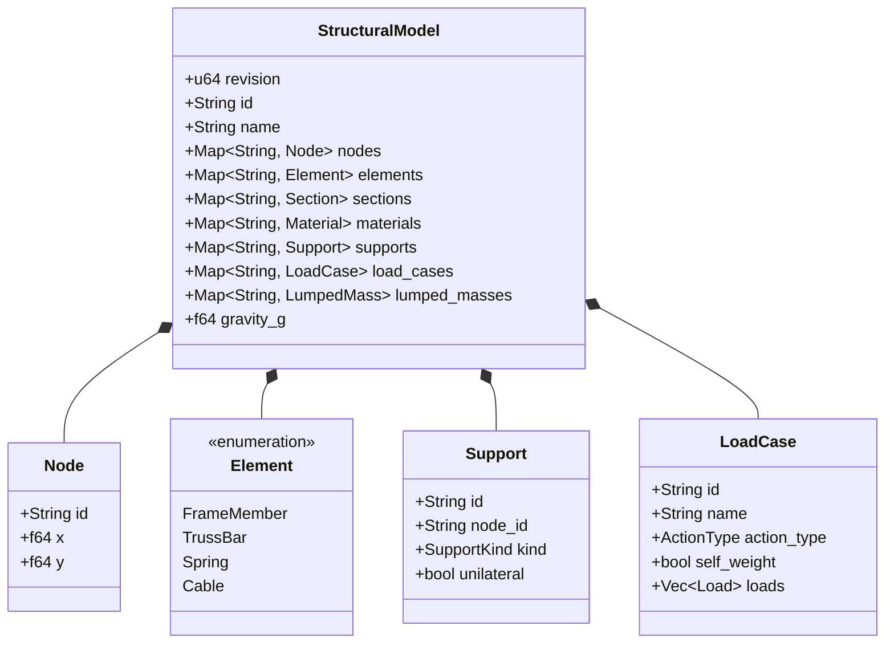

# Canonical Domain Model: 2D Frame Analysis Engine (`cap-frame-analysis-engine`)

- **Capability Owner:** `cap-frame-analysis-engine`
- **Upstream Artifacts:** [domain-glossary.md](domain-glossary.md), [prd.md](prd.md), [cross-capability-conventions.md](../cross-capability-conventions.md)
- **Shared Concerns:** `cap-eurocode-actions-combinations` (`ActionType`, `Combination`, `DesignSpectrum`)

---

## 1. Modeling Principles & Subdomain Structure

1. **Single Authoritative Model Owner:** `StructuralModel` is the sole canonical 2D structural representation across Mode 2 (Frame Modeler), Mode 3 (Teaching Classifier & DSM Walkthrough), Eurocode RC Design, and Project Persistence.
2. **Strict Revision Monotonicity:** Every state-changing operation on `StructuralModel` increments `revision: u64`. All computed artifacts (`Diagnostics`, `ResultSet`, `Envelope`, `DsmWalkthroughData`, `AnalysisJob`) are immutable value snapshots stamped with the exact `revision` they were derived from.
3. **Subdomains within `cap-frame-analysis-engine`:**
   - **Topology & Physical Properties Core:** `StructuralModel`, `Node`, `Element`, `Section`, `Material`, `Support`, `LoadCase`, `Load`, `LumpedMass`.
   - **Kinematics & Pre-Solve Diagnostics:** DOF numbering, static condensation of `EndRelease`s, `RigidOffset` transformations, rank/nullspace `MechanismMode` extraction.
   - **Linear & Educational DSM Core:** Linear static solver, analytical internal force polynomials $M(x), Q(x), N(x)$, superposition, and `DsmWalkthroughData`.
   - **Nonlinear & Stability Core:** Unilateral active-set solver, 2nd-order $P\text{-}\Delta / P\text{-}\delta$ geometric stiffness $\mathbf{K}_G$, linear eigenvalue buckling, and Irvine elastic catenary `Cable` solver.
   - **Structural Dynamics & Seismic Core:** Mass matrix assembly, Lanczos/generalized eigensolver (`Modal`), `LateralForce`, and `ResponseSpectrum` (SRSS/CQC).

---

## 2. Aggregate Design

### 2.1 Aggregate Root: `StructuralModel`
- **Why one aggregate:** Structural validity (referential integrity of nodes, sections, materials, supports, and loads) and revision tracking must change atomically. A mutation to a node coordinate invalidates element lengths, cable unstressed states, and stiffness matrices simultaneously.
- **Aggregate Root Attributes:**
  - `id: String` (UUID or project-scoped identifier)
  - `revision: u64` (starts at `1`, increments on every command mutation)
  - `nodes: IndexMap<NodeId, Node>` (ordered map preserving deterministic DOF numbering)
  - `elements: IndexMap<ElementId, Element>`
  - `sections: IndexMap<SectionId, Section>`
  - `materials: IndexMap<MaterialId, Material>`
  - `supports: IndexMap<SupportId, Support>`
  - `load_cases: IndexMap<LoadCaseId, LoadCase>`
  - `lumped_masses: IndexMap<NodeId, LumpedMass>`
  - `gravity_accel: f64` (default $9.81\text{ m/s}^2$)

### 2.2 Aggregate Root: `AnalysisJob` (Execution Lifecycle Aggregate)
- Tracks background asynchronous execution of nonlinear (`SecondOrderPDelta`, `LinearBuckling`, or models containing `Cable` / unilateral elements) and dynamic (`Modal`, `ResponseSpectrum`, `LateralForce`) analyses.
- **Attributes:** `job_id: String`, `model_revision: u64`, `kind: AnalysisKind`, `target_ids: Vec<String>`, `status: JobStatus` (`Queued | Running | Converged | Failed | Cancelled | Superseded`), `progress_percent: f32`, `current_iteration: u32`, `current_residual: Option<f64>`.

---

## 3. Entities & Value Objects

### 3.1 `Node` (Entity)
- `id: String` (`"N1"`, `"N2"`, …)
- `x: f64`, `y: f64` (metres in global Cartesian coordinates; finite numbers).

### 3.2 `Element` (Entity — Polymorphic Union)
Every `Element` carries `id: String` (`"E1"`, `"E2"`, …) and belongs to one of four variants:

1. **`FrameMember` (6-DOF Euler-Bernoulli Beam-Column):**
   - `node_i: NodeId`, `node_j: NodeId` ($i \neq j$, clear length $L_{\text{eff}} > 10^{-4}\text{ m}$)
   - `section_id: SectionId`, `material_id: MaterialId`
   - `release_i: EndRelease`, `release_j: EndRelease` where `EndRelease = { axial: bool, shear: bool, moment: bool }`
   - `offset_i: RigidOffset`, `offset_j: RigidOffset` where `RigidOffset = { dx: f64, dy: f64, frame: OffsetFrame (Global | Local) }`
   - **Formulation:** Local $6 \times 6$ stiffness $\mathbf{k}_{\text{local}}$ in clear span $L_{\text{eff}}$; static condensation zeroes out released DOFs ($u_{x,i}, u_{y,i}, \theta_{z,i}, u_{x,j}, u_{y,j}, \theta_{z,j}$) and modifies both $\mathbf{k}_{\text{local}}$ and fixed-end force vector $\mathbf{f}_{0,\text{local}}$ consistently; kinematic rigid offset matrix $\mathbf{T}_{\text{offset}}$ maps clear-span ends to node centers before rotation $\mathbf{T}_{\text{rot}}(\alpha)$ to global DOFs.

2. **`TrussBar` (Pin-Ended Axial Member):**
   - `node_i: NodeId`, `node_j: NodeId`
   - `section_id: SectionId`, `material_id: MaterialId`
   - `axial_behavior: AxialBehavior` (`Both` | `TensionOnly` | `CompressionOnly`)
   - **Formulation:** Contributes only axial stiffness $EA/L$ along chord direction $(\cos\alpha, \sin\alpha)$ to translational DOFs $(u_x, u_y)$. Does not activate rotational DOFs $\theta_z$.

3. **`Spring` (Discrete Translational/Rotational Spring):**
   - `node_i: NodeId`, `node_j: Option<NodeId>` (`None` = grounded spring; `Some(nj)` = two-node link spring)
   - `kx: f64` ($\text{kN/m} \ge 0$), `ky: f64` ($\text{kN/m} \ge 0$), `ktheta: f64` ($\text{kNm/rad} \ge 0$)
   - `angle_deg: f64` (orientation of local $x$-axis of the spring relative to global $+X$).

4. **`Cable` (Exact Irvine 2D Elastic Catenary):**
   - `node_i: NodeId`, `node_j: NodeId`
   - `section_id: SectionId`, `material_id: MaterialId`
   - `prestress: CablePrestress` — enum with exactly one active definition:
     - `UnstressedLength { l0: f64 }` ($L_0 > 0\text{ m}$)
     - `SagRatio { sag_to_span: f64 }` ($f / L_c \in (10^{-4}, 0.5)$ under self-weight at initial chord)
     - `Pretension { t0: f64 }` (initial chord tension $T_0 > 0\text{ kN}$ at initial node positions)
   - **Formulation:** Self-weight per unit unstressed length $w_0 = \max(\gamma \cdot A, w_{\min})$. At each global Newton-Raphson step, solves the $2\times 2$ catenary compatibility system for horizontal and vertical end reactions $(H, V)$ at node $j$ given current relative span $(\Delta x, \Delta y)$, assembling the exact $4\times 4$ translational tangent stiffness $\mathbf{k}_{T,\text{cable}}$. If $H \le 10^{-6}\text{ kN}$ or cable goes slack in a weightless limit ($w_0 \to 0, L_{\text{chord}} \le L_0$), flags `cable_slack: true` in `Diagnostics` and applies a minimum regularization tangent $k_{\text{reg}} = 10^{-7} EA/L_0$.

### 3.3 `Section` & `Material` (Entities / Library Items)
- **`Section`:** `id: String`, `name: String`, `source: LibrarySource` (`Preset { catalog_id }` | `Custom`), `shape: SectionShape` (`Ipe`, `Hea`, `Heb`, `HollowRect`, `HollowCirc`, `Rectangular`, `Circular`, `Generic`), `area_a: f64` ($\text{m}^2 > 0$), `inertia_i: f64` ($\text{m}^4 > 0$), `shear_area_av: Option<f64>` ($\text{m}^2$), `depth_h: Option<f64>` ($\text{m} > 0$, mandatory if thermal gradient loads apply).
- **`Material`:** `id: String`, `name: String`, `source: LibrarySource`, `class: MaterialClass` (`Concrete`, `Steel`, `Timber`, `CableSteel`, `Custom`), `e_gpa: f64` ($> 0$, converted to $E = e_{\text{gpa}} \times 10^6\text{ kN/m}^2$), `g_gpa: f64`, `density_gamma: f64` ($\text{kN/m}^3 \ge 0$), `alpha_t: f64` ($1/^\circ\text{C} \ge 0$).

### 3.4 `Support` (Entity)
- `id: String`, `node_id: NodeId`, `unilateral: bool`
- `kind: SupportKind`:
  - `Fixed`: restrains $(u_x, u_y, \theta_z)$
  - `Pinned`: restrains $(u_x, u_y)$
  - `Roller { angle_deg: f64 }`: restrains displacement normal to rolling plane ($u_n$ along $\text{angle\_deg} + 90^\circ$); when `unilateral: true`, only resists $R_n \ge 0$ (compression into support)
  - `Guided { angle_deg: f64 }`: restrains normal displacement $u_n$ and rotation $\theta_z$, allows sliding along `angle_deg`
  - `Elastic { kx: f64, ky: f64, ktheta: f64 }`: adds spring stiffnesses to node DOFs; when `unilateral: true`, vertical/normal spring $k_y$ is active only in compression ($u_y \le 0$).

### 3.5 `LoadCase`, `Load` & `LumpedMass`
- **`LoadCase`:** `id: String` (`"LC1"`, …), `name: String`, `action_type: ActionType`, `self_weight: bool`, `loads: Vec<Load>`.
- **`Load` (Value Object Union):**
  - `NodalLoad { node_id, fx: f64, fy: f64, mz: f64 }`
  - `MemberPointLoad { element_id, fx: f64, fy: f64, mz: f64, x_ratio: f64, frame: LoadFrame (Local | Global) }` with $x_{\text{ratio}} \in [0, 1]$
  - `MemberDistributedLoad { element_id, qx1: f64, qy1: f64, qx2: f64, qy2: f64, a_ratio: f64, b_ratio: f64, frame: LoadFrame (Local | Global | Projected) }` with $0 \le a_{\text{ratio}} < b_{\text{ratio}} \le 1$
  - `SupportSettlement { support_id, dx: f64, dy: f64, dtheta: f64 }`
  - `ThermalLoad { element_id, dt_uniform: f64, dt_gradient: f64 }` where $\kappa_T = \alpha_T \cdot \Delta T_{\text{gradient}} / h$ and $\varepsilon_0 = \alpha_T \cdot \Delta T_{\text{uniform}}$.
- **`LumpedMass`:** `node_id: NodeId`, `mass_x_t: f64` ($\ge 0$), `mass_y_t: f64` ($\ge 0$), `inertia_theta_tm2: f64` ($\ge 0$).

### 3.6 `Diagnostics`, `ResultSet`, `Envelope` & `DsmWalkthroughData` (Read-Model Value Objects)
- **`Diagnostics`:** `revision: u64`, `static_indeterminacy_degree: i32`, `kinematic_instability_degree: u32`, `free_dofs: usize`, `is_stable: bool`, `mechanism_modes: Vec<MechanismMode>`, `warnings: Vec<DiagnosticMessage>`.
- **`ResultSet`:** `revision: u64`, `target_id: String`, `target_kind: TargetKind (LoadCase | Combination)`, `analysis_kind: AnalysisKind`, `superposition_valid: bool`, `nodal_displacements: Vec<NodalDisplacement>`, `support_reactions: Vec<SupportReaction>`, `member_results: Vec<MemberResult>`, `cable_results: Vec<CableResult>`, `buckling_modes: Option<Vec<BucklingModeResult>>`, `modal_results: Option<ModalAnalysisResult>`.
  - Each `MemberResult` contains `end_forces_local`, `stations: Vec<DiagramStation>` (`x`, `n_kn`, `q_kn`, `m_knm`, `ux_local_m`, `uy_local_m`, `theta_rad`), and `extrema: MemberExtrema` (`min_n`, `max_n`, `min_q`, `max_q`, `min_m`, `max_m`, `max_deflection`).
- **`Envelope`:** `revision: u64`, `analysis_kind: AnalysisKind`, `combination_ids: Vec<String>`, `member_envelopes: Vec<MemberEnvelope>` (per-station `max_m`, `min_m`, `max_q`, `min_q`, `max_n`, `min_n`, each paired with `governing_combination_id`), `reaction_envelopes: Vec<ReactionEnvelope>`, `displacement_envelopes: Vec<DisplacementEnvelope>`.

---

## 4. Domain Invariants

| ID | Invariant | Enforcement Boundary |
| --- | --- | --- |
| **INV-01** | Every `Element` connects distinct `Node` IDs that exist in `StructuralModel.nodes`, with Euclidean clear length $L_{\text{eff}} \ge 10^{-4}\text{ m}$. (`Spring` with `node_j = None` is exempt from two-node length check.) | Model mutation & pre-solve validation (`INVALID_ELEMENT_GEOMETRY`) |
| **INV-02** | At most one `Support` entity may be attached to any single `NodeId`. | Model mutation (`DUPLICATE_NODE_SUPPORT`) |
| **INV-03** | A `FrameMember` cannot release both `axial: true` at start and `axial: true` at end simultaneously without causing an internal axial rigid-body mode; releasing all rotational connections at a node with no rotational spring/support triggers a local rotational mechanism. | Pre-solve rank/mechanism analyzer (`KINEMATIC_INSTABILITY`) |
| **INV-04** | `MemberPointLoad`, `MemberDistributedLoad`, and `ThermalLoad` may only target `FrameMember` or `TrussBar` (thermal uniform only on `TrussBar`); applying a thermal gradient $\Delta T_{\text{gradient}} \neq 0$ to a `Section` with `depth_h == None` is forbidden. | Pre-solve validation (`INVALID_LOAD_ASSIGNMENT`, `MISSING_SECTION_DEPTH_FOR_THERMAL_GRADIENT`) |
| **INV-05** | Linear superposition of `LoadCase` `ResultSet`s is strictly forbidden when `StructuralModel` contains any `Cable`, any `Support` with `unilateral == true`, any `TrussBar` with `axial_behavior != Both`, or when `AnalysisKind == SecondOrderPDelta`. | Solver orchestration policy (`superposition_valid = false`) |
| **INV-06** | No `ResultSet` or `Envelope` with `result.revision != model.revision` may be returned as current state or merged into an active `Envelope`. | Application / IPC boundary (`STALE_MODEL_REVISION`) |

---

## 5. Domain Services & Policies

1. **`KinematicDiagnosticsService`:** Computes active DOF map (excluding $\theta_z$ on nodes connected exclusively to `TrussBar`s, `Cable`s, or translational-only `Spring`s), evaluates static indeterminacy $n_s$, performs rank-revealing decomposition of $\mathbf{K}_{ff}$, and extracts normalized `MechanismMode` vectors when $n_k > 0$.
2. **`AnalyticalMemberDiagramService`:** Evaluates exact Euler-Bernoulli differential relationships $\frac{dN}{dx} = -p_x(x)$, $\frac{dQ}{dx} = -p_y(x)$, $\frac{dM}{dx} = Q(x)$ (under Greek sign convention where $+y_{\text{local}}$ is upwards, $M > 0$ tensions bottom $-y_{\text{local}}$ fibre) and integrates local deflection $EI v''(x) = M(x) - EI \kappa_T$ analytically across all interior point and trapezoidal load segments.
3. **`NonlinearConvergencePolicy`:**
   - Unilateral active-set: max 50 iterations; flip damping if cyclic state oscillation (period-2 cycle) is detected; convergence when active set is unchanged and $\|\mathbf{r}\|_2 / \max(1.0, \|\mathbf{F}\|_2) < 10^{-6}$.
   - $P\text{-}\Delta$: max 30 iterations; relative displacement norm $< 10^{-5}$; abort with `PDELTA_BUCKLING_DIVERGENCE` if $\mathbf{K}_E + \mathbf{K}_G$ becomes non-positive-definite.
   - Catenary Newton-Raphson: inner loop tolerance $10^{-10}$ (max 40 iterations); outer global equilibrium tolerance $10^{-6}$ (max 80 iterations with Armijo backtracking line search).

---

## 6. Domain Events

- `StructuralModelMutated { model_id, new_revision, mutation_summary }` — triggers cancellation of any in-flight `AnalysisJob` with `job.model_revision < new_revision`.
- `AnalysisJobProgressUpdated { job_id, revision, kind, status, progress_percent, current_target, iteration, residual }` — emitted over `analysis://progress` during nonlinear/dynamic solves.
- `AnalysisJobCompleted { job_id, revision, kind, status }` — notifies listeners that nonlinear/dynamic `ResultSet`s and `Envelope`s are ready.
