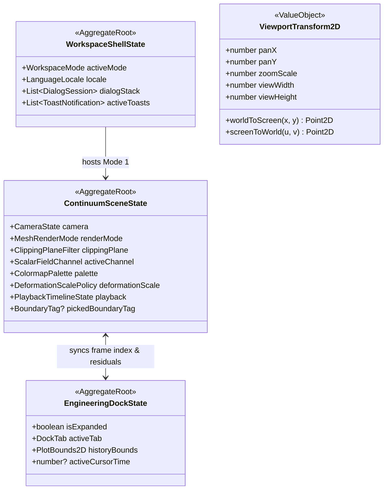

# Canonical Domain Model: Interactive 3D Visualization Canvas & UI (`cap-interactive-canvas`)

- **Capability Owner:** [`cap-interactive-canvas`](../../../.okf/capabilities/cap-interactive-canvas.md)
- **Upstream References:** [`prd.md`](prd.md), [`domain-glossary.md`](domain-glossary.md), [`cross-capability-conventions.md`](../cross-capability-conventions.md)
- **Status:** Canonical Reference (2026-11-01)

---

## 1. Purpose & Modeling Principles

This document defines the architecture-neutral domain model for `cap-interactive-canvas`. Because this capability owns interactive scientific visualization, workspace state orchestration, and shared 2D/3D rendering rules, its domain concepts represent **visual presentation state, coordinate transformations, field transfer policies, interactive selection invariants, and analytics projections**—strictly separated from numerical solver internals (`cap-solver-core`, `cap-frame-analysis-engine`).

### Modeling Principles
1. **Non-Destructive Visual Projection:** Visual policies (`DeformationScalePolicy`, `ClippingPlaneFilter`, `ColormapPalette`, `ViewportTransform2D`) transform raw physical coordinates and scalar arrays into display representations without mutating the underlying physical DTOs.
2. **Revision & Mesh Consistency:** Any change to mesh topology or model `revision` invalidates dependent visual field overlays and active boundary facet selections.
3. **Unified Coordinate & Sign Semantics:** Engineering world coordinates always obey SI units and $+y$ up (2D) / right-handed $(x, y, z)$ (3D); screen/WebGL projections encapsulate axis inversion and aspect-ratio fitting inside dedicated value objects.

---

## 2. Subdomains & Bounded Context Seam

| Subdomain | Type | Responsibility |
| --- | --- | --- |
| **Workspace Shell & Modal Orchestration** | Supporting | Manages active `WorkspaceMode` (`continuum`, `structural`, `teaching`), bilingual `LanguageLocale` (`el`, `en`), LIFO `DialogSession` stack with `DismissGuard`, and deduplicated `ToastNotification` queue. |
| **3D/2D Continuum Scene & Field Visualization** | Core | Manages camera spherical state, `CameraProjectionMode`, `MeshRenderMode`, `ClippingPlaneFilter`, raycast `BoundaryFacetPick` / `BoundaryConditionAssignment`, `ScalarFieldChannel` vertex mapping via `ColormapPalette`, `DeformationScalePolicy`, `VectorGlyphOverlay`, and `PlaybackTimelineController`. |
| **Engineering Analytics Dock** | Core | Projects solver time histories, iterative convergence residuals, and parametric benchmark sweeps into interactive SVG coordinates (`ResponseHistoryCurve`, `ConvergenceResidualTrace`, `ParametricSweepChart`) synchronized with the playback cursor. |
| **Shared 2D Structural Viewport Kernel** | Shared Kernel | Provides `ViewportTransform2D`, `TensionSideDiagram` geometry generation, and `SemanticColorTokens` consumed by Mode 2 (`cap-sketcher-frame-modeler`) and Mode 3 (`cap-structural-mechanics-teaching`). |

---

## 3. Aggregates, Entities & Value Objects

### 3.1 Aggregate Root: `WorkspaceShellState`
- **Root Identity:** Singleton per desktop window session.
- **Owned Entities & Value Objects:**
  - `activeMode`: `WorkspaceMode` (`'continuum' | 'structural' | 'teaching'`).
  - `locale`: `LanguageLocale` (`'el' | 'en'`, default `'el'`).
  - `dialogStack`: ordered LIFO list of `DialogSession` entities (`id`, `title`, `eyebrow`, `description`, `size: 'standard' | 'wide'`, `dismissible: boolean`, `dismissGuard: () => boolean`).
  - `activeToasts`: list of `ToastNotification` entities (`id`, `message`, `type: 'info' | 'success' | 'warning' | 'error'`, `expiresAtMs`).

### 3.2 Aggregate Root: `ContinuumSceneState`
- **Root Identity:** Bound to the Mode 1 `ContinuumViewport` instance.
- **Owned Value Objects & Entities:**
  - `camera`: `CameraState` (`projection: 'Perspective' | 'Orthographic'`, `spherical: { radius, theta, phi }`, `target: Vector3`).
  - `visibilityFlags`: `{ showColormap: boolean, showWireframe: boolean, showBoundaries: boolean, showNodes: boolean, showVectorGlyphs: boolean }`.
  - `renderMode`: `MeshRenderMode` (`'SurfaceSolid' | 'WireframeOverlay' | 'VolumeEdgesOnly'`).
  - `clippingPlane`: `ClippingPlaneFilter` (`enabled: boolean`, `axis: 'X' | 'Y' | 'Z'`, `normalizedOffset: number` in $[-1, 1]$, `invertNormal: boolean`).
  - `activeChannel`: `ScalarFieldChannel` (`'Material' | 'VonMises' | 'PrincipalStress' | 'Displacement'`).
  - `palette`: `ColormapPalette` (`'Turbo' | 'Viridis' | 'Coolwarm' | 'Jet'`).
  - `deformationScale`: `DeformationScalePolicy` (`mode: 'Auto' | 'Manual'`, `scaleFactor: number` in $[1, 20000]$).
  - `pickedBoundaryTag`: optional `BoundaryTag` (`'Left' | 'Right' | 'Top' | 'Bottom' | 'Front' | 'Back' | 'Hole' | 'Default'`) selected via 3D/2D raycasting, paired with `BoundaryConditionAssignment` (`kind: 'Dirichlet' | 'Neumann' | 'Robin'`, parameters).
  - `playback`: `PlaybackTimelineState` (`regime: 'Static' | 'Harmonic' | 'Transient'`, `isPlaying: boolean`, `currentFrameIndex: number`, `harmonicPhaseRad: number` in $[0, 2\pi)$).

### 3.3 Aggregate Root: `EngineeringDockState`
- **Root Identity:** Bound to the Mode 1 `EngineeringDock` panel.
- **Owned Value Objects:**
  - `isExpanded`: `boolean` (default `true`).
  - `activeTab`: `'history' | 'diagnostics' | 'sweep'`.
  - `historyBounds`: `PlotBounds2D` (`maxT: number`, `maxDispMm: number`, `staticEulerBernoulliMm: number | null`).
  - `hoverSample`: optional `{ time: number, talbotMm?: number, newmarkMm?: number, screenX: number, screenY: number }`.

### 3.4 Shared Kernel Value Objects (`ViewportTransform2D` & `TensionSideDiagram`)
- **`ViewportTransform2D`:**
  - Encapsulates `viewWidth`, `viewHeight`, `margin`, `panOffset: { dx, dy }`, and `scale: number` (pixels per metre).
  - Provides invertible pure mappings:
    $$\text{worldToScreen}(x, y) = \bigl(u_0 + s(x - x_{\text{ref}}),\; v_0 - s(y - y_{\text{ref}})\bigr)$$
    $$\text{screenToWorld}(u, v) = \left(x_{\text{ref}} + \frac{u - u_0}{s},\; y_{\text{ref}} - \frac{v - v_0}{s}\right)$$
- **`TensionSideDiagram`:**
  - For a 2D member from $(x_0, y_0)$ to $(x_1, y_1)$ with unit direction $(\cos\theta, \sin\theta)$ and tension-side normal $\mathbf{n}_{\text{tens}}$ pointing toward local $-y$ (screen downward for horizontal beams), computes the SVG closed path polygon for $M(x)$, $Q(x)$, $N(x)$, or `Envelope` min/max bands.

---

## 4. Policies, Domain Services & Invariants

### 4.1 Hard Invariants
- **INV-1 (Dialog LIFO & DismissGuard Integrity):** Only the top-most `DialogSession` (`dialogStack.at(-1)`) may receive close or dismiss actions. A `dismiss()` request is rejected if `dismissible === false` or `dismissGuard() === false`.
- **INV-2 (Toast Deduplication):** Adding a `ToastNotification` with an identical `(message, type)` pair to an currently visible toast must not append a duplicate entry; instead it resets the 5000 ms dismissal timer on the existing entry.
- **INV-3 (Spherical Camera Singularity Clamp):** Polar angle $\phi$ in `CameraState` must remain clamped within $[0.05, \pi - 0.05]$ radians and radius $r \in [0.5, 250]$ to prevent gimbal flip at the poles.
- **INV-4 (Scalar Normalization Safety):** When mapping `ScalarFieldChannel` values $v_i \in [v_{\min}, v_{\max}]$ to normalized $t_i \in [0, 1]$, the denominator span is $\Delta v = (v_{\max} - v_{\min} > 10^{-9}) \;?\; (v_{\max} - v_{\min}) : 1.0$, and $t_i = \text{clamp}((v_i - v_{\min})/\Delta v, 0, 1)$.
- **INV-5 (Clipping Plane World-Space Bound):** A `ClippingPlaneFilter` with normalized offset $s \in [-1, 1]$ along axis $k \in \{X, Y, Z\}$ maps to world plane constant $d = -\bigl(c_k + \frac{s}{2}(b_{\max,k} - b_{\min,k})\bigr)$ where $[b_{\min}, b_{\max}]$ is the active mesh bounding box and $c_k$ is its midpoint.
- **INV-6 (Tension-Side Plotting Rule):** Positive bending moment $M(x) > 0$ (bottom fibre in tension) is always offset in the direction of the local $-y$ fibre in both Mode 2 and Mode 3.

### 4.2 Domain Policies
- **POL-1 (`AutoScaleDeformationPolicy`):** When simulation results arrive with $\max \|\mathbf{u}\| > 10^{-12}\text{ m}$ and maximum mesh span $L_{\max} = \max(\Delta X, 1.0)$, if the current visual deflection $\alpha_{\text{def}} \cdot \max \|\mathbf{u}\|$ falls outside $[0.02 L_{\max}, 0.40 L_{\max}]$, `autoScale()` sets $\alpha_{\text{def}} = \max(1, \text{round}(0.08 L_{\max} / \max \|\mathbf{u}\|))$ (rounded to nearest 50 when $>100$).
- **POL-2 (`ColormapTransferPolicy`):** Evaluates normalized $t \in [0, 1]$ into RGB $[r, g, b] \in [0, 1]^3$ using the selected `ColormapPalette` (`Turbo` degree-5 polynomial, `Viridis`, `Coolwarm`, or `Jet`).

---

## 5. Lifecycle Rules & Domain Events

### Key Domain Events
| Event Name | Trigger | Payload / Subscribers |
| --- | --- | --- |
| `WorkspaceModeSwitched` | User selects Mode 1, 2, or 3 in header | `{ previousMode, nextMode }` → activates target workspace view |
| `LanguageLocaleChanged` | User toggles `EL` / `EN` | `{ locale: 'el' \| 'en' }` → triggers reactive re-render of all translated strings |
| `BoundaryFacetPicked` | User clicks a 2D/3D boundary element in `ContinuumViewport` | `{ tag: BoundaryTag, elementIndex: number, worldPoint: [number, number, number] }` → highlights facet group & opens BC assignment |
| `ClippingPlaneUpdated` | User toggles or scrubs 3D clipping slider | `{ enabled: boolean, axis: 'X'\|'Y'\|'Z', normalizedOffset: number, invert: boolean }` → updates WebGL clipping plane |
| `PlaybackFrameChanged` | Animation timer ticks or user scrubs viewport/dock timeline | `{ regime: 'Transient' \| 'Harmonic', frameIndex: number, timeSeconds: number, phaseRad: number }` → syncs 3D deformed mesh and dock cursor |
| `SolverConvergenceUpdated` | Tauri IPC emits iteration progress or completion | `{ iteration: number, residualNorm: number, relativeError: number }` → updates HUD badge and `EngineeringDock` table/chart |

---

## 6. Minimum Canonical Scenarios & Architecture Mapping

- **Canonical Scenarios:** Covered in [`acceptance-scenarios.md`](acceptance-scenarios.md) (`SC-001` to `SC-012`).
- **Angular 22 + Three.js Implementation Mapping:**
  - Aggregate state maps cleanly to Angular `signal()` and `computed()` selectors (`AppComponent`, `ViewportComponent`, `BottomDockComponent`, `DialogService`, `NotificationService`, `I18nService`).
  - Pure mathematical policies (`ColormapTransferPolicy`, `AutoScaleDeformationPolicy`, `ViewportTransform2D`, `TensionSideDiagram`) are implemented as stateless pure TypeScript functions testable under the Vitest `frontend-integration` harness without requiring a live WebGL context.
