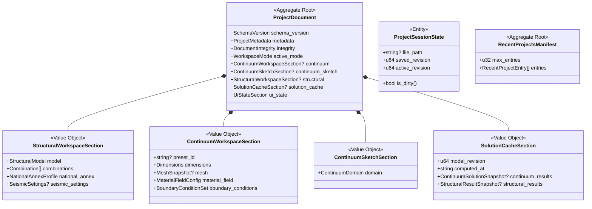
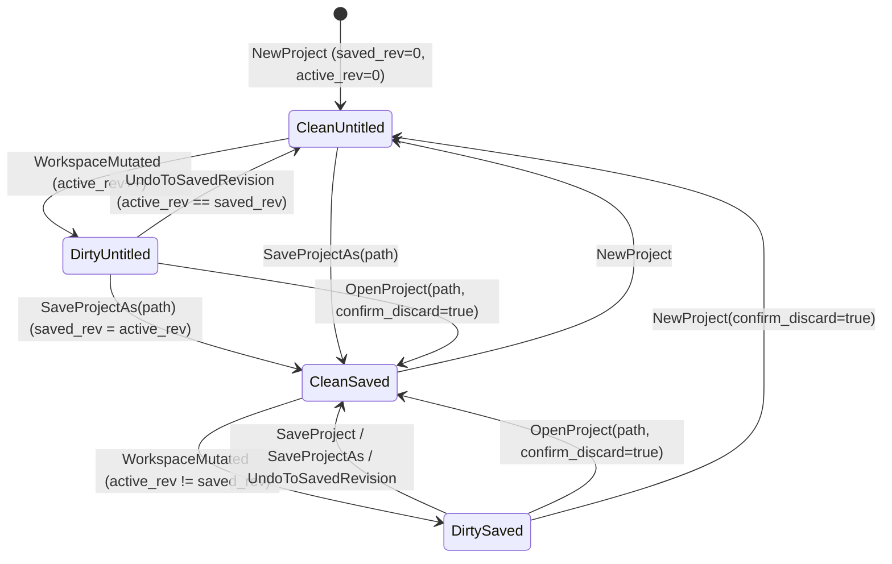

# Canonical Domain Model: Project Persistence & Self-Contained Workspace Storage (`cap-project-persistence`)

- **Owning Capability:** [`cap-project-persistence`](../../../.okf/capabilities/cap-project-persistence.md)
- **Node PRD:** [`prd.md`](prd.md)
- **Domain Glossary:** [`domain-glossary.md`](domain-glossary.md)
- **Conventions Reference:** [`cross-capability-conventions.md`](../cross-capability-conventions.md)
- **Status:** Canonical Domain Model (2026-11-01)

---

## 1. Purpose & Modeling Principles

This document defines the architecture-neutral semantic model for `cap-project-persistence`. It governs how OmniMechanics packages multi-workspace engineering state into a versioned `ProjectDocument`, verifies integrity, migrates legacy schemas, tracks dirty revisions in `ProjectSessionState`, manages the `RecentProjectsManifest`, and specifies `DiagramExportSpec`.

**Core Principles:**
1. **Envelope Ownership Only:** `cap-project-persistence` owns the outer `ProjectDocument` aggregate, migration pipeline, session revision tracking, and MRU manifest. It embeds `StructuralModel` (`[frame]`), `Combination` / `NationalAnnexProfile` / `SeismicSettings` (`[actions]`), and `ContinuumDomain` (`[continuum]`) by canonical value schema without duplicating domain mechanics logic.
2. **Deterministic Serialization:** Every `ProjectDocument` has a unique canonical byte representation for its payload sections so SHA-256 integrity checks and Git diffs are deterministic across OS platforms.
3. **Revision-Driven Dirty Semantics:** Dirty state is a pure function of `(saved_revision, active_revision)`.

---

## 2. Subdomains & Bounded Context Seam

| Subdomain | Type | Responsibility |
| :--- | :--- | :--- |
| **Document Serialization & Integrity** | Core (within node) | Assembling, canonicalizing, hashing, parsing, and validating `.bem` `ProjectDocument` files. |
| **Schema Evolution & Migration** | Supporting | Upgrading older `.bem` schema versions (`1.0` -> `1.x`) via pure step functions and rejecting unsupported versions. |
| **Workspace Session & Dirty Tracking** | Supporting | Tracking active file path, `saved_revision`, `active_revision`, and enforcing the `UnsavedChangesGuard`. |
| **Recent Projects (MRU) Management** | Supporting | Persisting and pruning the bounded list of recently opened `.bem` paths in user app-data storage. |
| **Diagram Export Specification** | Supporting | Packaging canvas vector/raster rendering parameters and writing standalone `.svg` / `.png` deliverables. |

---

## 3. Aggregate Roots, Entities & Value Objects

### 3.1 Aggregate Root: `ProjectDocument`
Represents the complete, self-contained `.bem` file content.
- **`schema_version`** (`SchemaVersion`): String in `"MAJOR.MINOR"` format (current canonical version: `"1.0"`).
- **`metadata`** (`ProjectMetadata`):
  - `project_id`: UUID v4 string, generated on `New Project` and preserved across `Save` (regenerated on `Save As` only when cloning to a new identity, or preserved per user session).
  - `title`: Non-empty human-readable project title (default `"Untitled Project"` / `"Ανώνυμο Έργο"`).
  - `author`: Optional string.
  - `description`: Optional string.
  - `created_at`: RFC 3339 UTC timestamp string.
  - `updated_at`: RFC 3339 UTC timestamp string.
  - `app_version`: Semantic version of OmniMechanics that wrote the file (e.g., `"0.2.0"`).
  - `dimensions`: `"2D"` or `"3D"`.
- **`integrity`** (`DocumentIntegrity`):
  - `algorithm`: `"SHA-256"`.
  - `payload_sha256`: 64-character lowercase hex digest computed over the canonical JSON serialization of `{ active_mode, continuum, continuum_sketch, structural, solution_cache, ui_state }`.
- **`active_mode`** (`WorkspaceMode`): `"ContinuumWorkbench"` | `"StructuralModeler"` | `"TeachingStudio"`.
- **`continuum`** (`Option<ContinuumWorkspaceSection>`):
  - `preset_id`: Optional parametric preset identifier (`[cap-geometry-presets]`).
  - `geometry_params`: Key-value map of finite `f64` geometric parameters.
  - `mesh`: Optional embedded mesh topology (`nodes: [[f64; 3]]`, `boundary_elements: [[usize; N]]`, `volume_elements: [[usize; M]]`).
  - `material_field`: Homogeneous reference moduli ($E_0, \nu_0, \rho_0$) and active inhomogeneity profile (`Homogeneous`, `Layered`, `FunctionalGradation`, `Inclusions`).
  - `boundary_conditions`: Face/node set mappings to prescribed displacements or tractions and excitation regime (`Static`, `Harmonic { omega }`, `Transient { dt, steps }`).
- **`continuum_sketch`** (`Option<ContinuumSketchSection>`):
  - Embeds `ContinuumDomain` (`[continuum]`): outer closed counter-clockwise polygon loop, interior hole loops, boundary tags, and target mesh element size constraints.
- **`structural`** (`Option<StructuralWorkspaceSection>`):
  - `model`: `StructuralModel` (`[frame]`) carrying `revision: u64`, `nodes: Vec<Node>`, `elements: Vec<Element>` (`FrameMember` with `EndRelease` and `RigidOffset`, `TrussBar`, `Spring`, `Cable`), `sections: Vec<Section>`, `materials: Vec<Material>`, `supports: Vec<Support>`, `load_cases: Vec<LoadCase>` (each with `ActionType` and self-weight flag), `loads: Vec<Load>`, and `masses: Vec<NodalMass>`.
  - `combinations`: `Vec<Combination>` (`[actions]`) with `id`, `name`, `limit_state` (`ULS_STR`, `ULS_GEO`, `SLS_CHAR`, `SLS_FREQ`, `SLS_QP`, `SEISMIC`), `origin` (`Generated`, `UserEdited`, `Manual`), and `terms: Vec<{ load_case_id, factor }>`.
  - `national_annex`: `NationalAnnexProfile` (`[actions]`, default `"GR"`, with $\gamma$ and $\psi$ overrides).
  - `seismic_settings`: `Option<SeismicSettings>` (`[actions]`, EN 1998-1 zone, ground type `A`-`E`, importance class `I`-`IV`, behaviour factor $q$, spectrum parameters).
- **`solution_cache`** (`Option<SolutionCacheSection>`):
  - `model_revision`: `u64` matching the exact `StructuralModel.revision` (or Mode 1 edit revision) for which the cached results were computed.
  - `computed_at`: RFC 3339 UTC timestamp string.
  - `continuum_results`: Optional Mode 1 displacement/traction/stress fields and solver convergence history.
  - `structural_results`: Optional Mode 2 `Vec<ResultSet>` and `Vec<Envelope>` snapshots.
- **`ui_state`** (`UiStateSection`):
  - `language`: `"el"` | `"en"`.
  - `viewport`: `{ pan_x: f64, pan_y: f64, zoom: f64 }`.
  - `grid_snap`: `{ grid_step: f64, snap_grid: bool, snap_node: bool, snap_midpoint: bool, snap_intersection: bool, ortho: bool, angle_snap_deg: f64 }`.
  - `diagram_scales`: `{ moment_scale: f64, shear_scale: f64, axial_scale: f64, deformed_scale: f64 }`.
  - `active_target`: Optional `{ kind: "LoadCase" | "Combination" | "Envelope", id: String }`.

### 3.2 Entity: `ProjectSessionState`
Tracks the lifecycle and dirty status of the currently active workspace session in memory.
- **`session_id`**: UUID v4.
- **`file_path`**: `Option<String>` (absolute normalized filesystem path when backed by a saved `.bem` file; `None` for untitled new projects).
- **`saved_revision`**: `u64` (revision number at last `New`, `Open`, `Save`, or `Save As`).
- **`active_revision`**: `u64` (current workspace revision incremented on every model or workspace mutation, or restored on undo/redo).
- **`is_dirty`**: Derived boolean `active_revision != saved_revision`.
- **`last_saved_at`**: `Option<String>` (RFC 3339 UTC).

### 3.3 Aggregate Root: `RecentProjectsManifest`
Persisted separately in the platform application-data directory (`recent_projects.json`).
- **`max_entries`**: `u32` (constant `15`).
- **`entries`**: Ordered `Vec<RecentProjectEntry>` where each entry has `file_path: String`, `title: String`, `active_mode: WorkspaceMode`, `last_opened_at: String`, and `pinned: bool`.

### 3.4 Value Object: `DiagramExportSpec`
- **`output_path`**: Target filesystem path (`.svg` or `.png`).
- **`format`**: `"Svg"` | `"Png"`.
- **`theme`**: `"LightPrint"` (white background, high-contrast black/ink lines for printing) | `"DarkCanvas"` (matches dark workspace theme).
- **`width_px` / `height_px`**: Positive pixel dimensions ($100 \le W, H \le 16384$).
- **`dpi_scale`**: Scale multiplier for raster PNG export (`1.0`, `2.0`, `4.0`).
- **`include_title_block`**: `bool` (renders project title, active load case/combination name, units, and timestamp).
- **`include_legend`**: `bool` (renders M/Q/N sign convention and extrema summary).
- **`svg_markup`**: Complete serialized SVG document string supplied by the canvas renderer.

---

## 4. Domain Invariants & Policies

### 4.1 Hard Invariants
- **INV-P1 (Finite Numeric Invariant):** No numeric field anywhere in `ProjectDocument` may be `NaN`, `+Infinity`, or `-Infinity`. Serialization and deserialization reject non-finite floats with `PROJECT_CORRUPT_JSON`.
- **INV-P2 (Schema Version Format):** `schema_version` must match `^\d+\.\d+$`. Major version `1` is the only supported major version in this release (`SUPPORTED_MAJOR = 1`, `CURRENT_MINOR = 0`).
- **INV-P3 (Payload Checksum Integrity):** When `integrity.payload_sha256` is present, recomputing the SHA-256 digest over the canonicalized payload sections must equal `integrity.payload_sha256` (case-insensitive hex). Mismatch raises `PROJECT_CORRUPT_JSON`.
- **INV-P4 (Cache Revision Consistency):** If `solution_cache` is present alongside `structural`, `solution_cache.model_revision` must equal `structural.model.revision`. If unequal on load, `solution_cache` is stripped (`None`) and a `StaleCacheStripped` warning is emitted; stale results are never exposed as valid.
- **INV-P5 (Derived Dirty Invariant):** `ProjectSessionState.is_dirty()` is strictly `active_revision != saved_revision`.
- **INV-P6 (MRU Uniqueness & Bound):** `RecentProjectsManifest.entries` contains at most `max_entries` (15) items, has no duplicate normalized `file_path` values, and orders unpinned entries strictly by `last_opened_at` descending after pinned entries.

### 4.2 Domain Policies
- **Policy 1 — Forward/Backward Schema Migration Policy:**
  - *Same version (`1.0 == 1.0`):* Deserialize directly.
  - *Older minor version (`1.a` where `a < CURRENT_MINOR`):* Apply sequential pure migration functions $M_{1.a \to 1.(a+1)}$ filling default values for newly added optional fields and recording a `MigrationReport`.
  - *Newer minor/major version (`major > 1` or `1.b` where `b > CURRENT_MINOR`) or legacy pre-1.0 (`major < 1`):* Reject deterministically with `PROJECT_SCHEMA_UNSUPPORTED` without mutating session state.
- **Policy 2 — Atomic Persistence Policy:**
  - All writes of `.bem` files and `.svg`/`.png` exports write to `<target_path>.<pid>.tmp`, call `sync_all()` on the file descriptor, and invoke atomic filesystem rename to `<target_path>`.
- **Policy 3 — Unsaved Changes Guard Policy:**
  - Commands that replace the active session (`NewProject`, `OpenProject`, `CloseApplication`) require either `is_dirty == false` or an explicit `confirm_discard: true` flag (after user confirmation in the UI guard modal). Otherwise the command rejects with `PROJECT_UNSAVED_CHANGES`.

---

## 5. Lifecycle & State Transitions

---

## 6. Domain Events

| Event | Trigger | Payload |
| :--- | :--- | :--- |
| `ProjectCreated` | `NewProject` succeeds | `{ session_id, active_mode, revision: 0 }` |
| `ProjectLoaded` | `OpenProject` succeeds | `{ session_id, file_path, schema_migrated_from?, stale_cache_stripped: bool, revision }` |
| `ProjectSaved` | `SaveProject` / `SaveProjectAs` succeeds | `{ session_id, file_path, saved_revision, updated_at, payload_sha256 }` |
| `ProjectDirtyStateChanged` | Revision change flips `is_dirty` | `{ session_id, saved_revision, active_revision, is_dirty }` |
| `DiagramExported` | `ExportDiagram` succeeds | `{ output_path, format, bytes_written }` |
