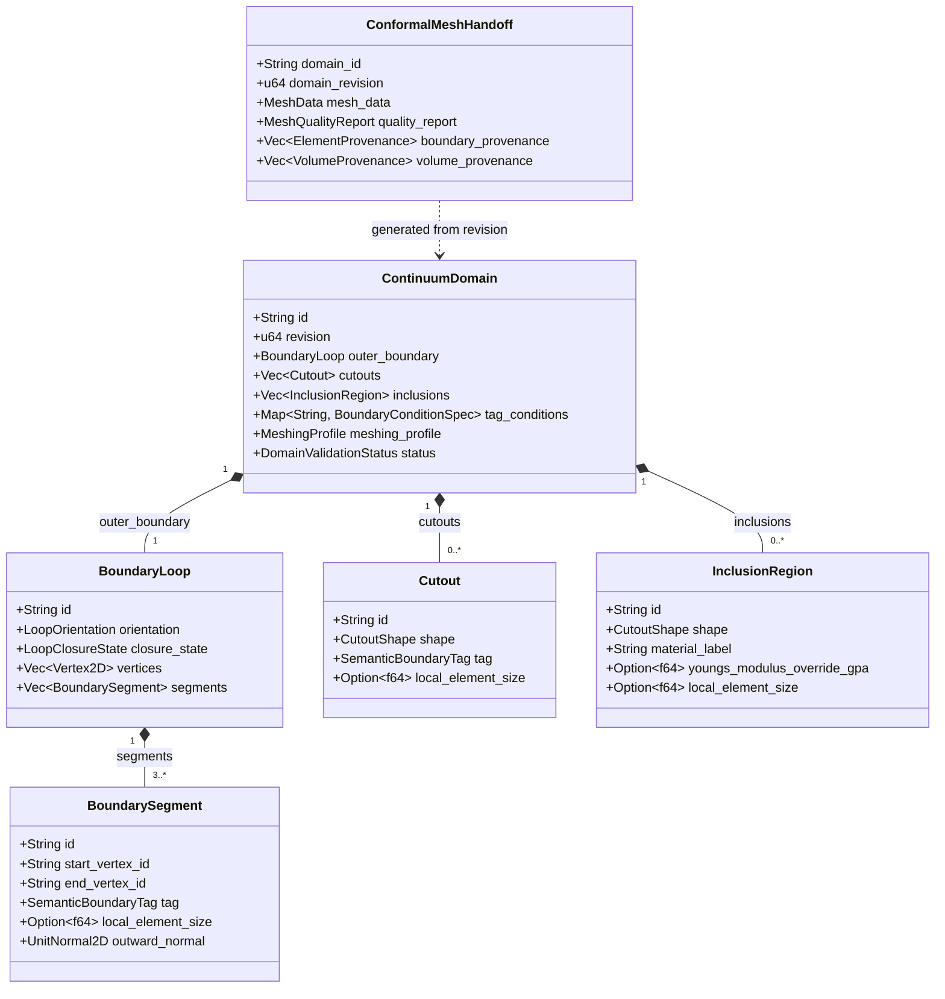
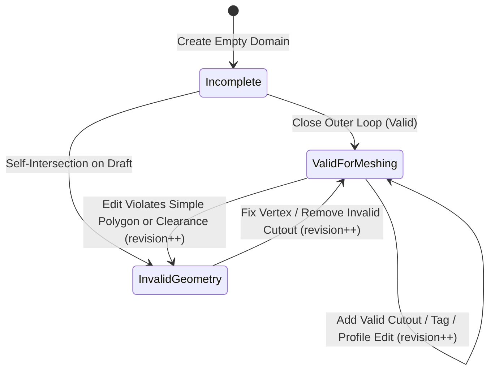

# Canonical Domain Model: Continuum Domain Sketcher (`cap-sketcher-continuum-domain`)

- **Owning Capability:** [`cap-sketcher-continuum-domain`](../../../.okf/capabilities/cap-sketcher-continuum-domain.md)
- **Upstream Artifacts:** [`domain-glossary.md`](domain-glossary.md), [`prd.md`](prd.md)
- **Shared Dependencies:** [`cap-geometry-presets`](../../../.okf/capabilities/cap-geometry-presets.md), [`cap-solver-core`](../../../.okf/capabilities/cap-solver-core.md), [`cap-material-field`](../../../.okf/capabilities/cap-material-field.md)
- **Binding Conventions:** [`cross-capability-conventions.md`](../cross-capability-conventions.md)

---

## 1. Purpose & Modeling Principles

This document defines the architecture-neutral canonical domain model for `cap-sketcher-continuum-domain`. It captures the aggregate boundaries, geometric entities, value objects, topological invariants, domain services, and Constrained Delaunay Triangulation (CDT) mesh handoff structures required to turn user-sketched 2D polygons, cutouts, and material inclusions into conformal `MeshData` packages for Mode 1 (`cap-solver-core`).

### Modeling Principles
1. **Strict Separation from `StructuralModel`:** `ContinuumDomain` models 2D planar solid regions for BEM-FEM continuum mechanics. It never shares entities with Mode 2 1D frame models.
2. **Exact Topological Conformity:** Boundary elements (`Line2`/`Line3`) are never meshed independently of volume elements (`Tri3`/`Quad4`); they are extracted directly from the constrained boundary edges of the 2D volume triangulation.
3. **Revision-Guarded Consistency:** Every domain mutation increments `ContinuumDomain.revision`, invalidating any prior `ConformalMeshHandoff`.

---

## 2. Subdomains & Bounded Context Alignment

| Subdomain | Role | Classification |
| --- | --- | --- |
| **Planar Boundary & Cutout Topology** | Representation and validation of closed simple polygon loops, circular/rectangular/polygonal holes, and solid inclusions with winding and clearance guarantees. | Core Domain |
| **Boundary Condition & Tag Mapping** | Semantic boundary tagging (`Left`, `Right`, `Top`, `Bottom`, `Hole`, custom) and physical boundary condition specification (Dirichlet, Neumann, Robin, Free). | Supporting Subdomain |
| **Conformal CDT Discretization** | Construction of the Planar Straight-Line Graph (PSLG), local feature size grading, Ruppert/Shewchuk Delaunay refinement, and extraction of conformal `MeshData`. | Core Domain |

---

## 3. Aggregate Design

### 3.1 Aggregate Root: `ContinuumDomain`
- **Identity:** Domain-scoped string ID (e.g., `"CD1"`) plus monotonically increasing `revision: u64` (starts at `1`).
- **Ownership:** Owns `outer_boundary: BoundaryLoop`, `cutouts: Vec<Cutout>`, `inclusions: Vec<InclusionRegion>`, `tag_conditions: BTreeMap<String, BoundaryConditionSpec>`, and `meshing_profile: MeshingProfile`.
- **Why One Aggregate:** Adding or moving a vertex on the outer boundary can invalidate the containment or minimum clearance of an interior `Cutout` or `InclusionRegion`. Therefore, all loops, holes, inclusions, and meshing parameters must be validated and mutated atomically within `ContinuumDomain`.

### 3.2 Read-Model / Handoff Product: `ConformalMeshHandoff`
- **Identity:** Bound to `(domain_id, domain_revision)`.
- **Ownership:** Contains the `cap-solver-core` `MeshData` (`dimension: 2`, `nodes: Vec<[f64; 3]>`, `boundary_elements: Vec<BoundaryElement>`, `volume_elements: Vec<VolumeElement>`, `stats: MeshStats`), `MeshQualityReport`, and provenance maps linking each `BoundaryElement` back to its parent `BoundarySegment` or `Cutout` ID and each `VolumeElement` to `"matrix"` or an `InclusionRegion` ID.

---

## 4. Entities & Value Objects

### 4.1 Entities (within `ContinuumDomain`)
1. **`BoundaryLoop`:**
   - `id: String` (`"L_OUTER"` for exterior loop, `"L_CUT_1"` for polygonal cutouts)
   - `orientation: LoopOrientation` (`CounterClockwise` for outer boundary, `Clockwise` for holes)
   - `closure_state: LoopClosureState` (`OpenDraft`, `ClosedValid`, `ClosedInvalid`)
   - `vertices: Vec<Vertex2D>` (ordered sequence $V_1, \dots, V_N$)
   - `segments: Vec<BoundarySegment>` (connecting $V_i \to V_{(i \bmod N)+1}$ when closed)
2. **`BoundarySegment`:**
   - `id: String` (`"S1"`, `"S2"`, ...)
   - `start_vertex_id: String`, `end_vertex_id: String`
   - `tag: SemanticBoundaryTag`
   - `local_element_size: Option<f64>` (optional local edge size $h_{\text{local}}$ in m)
   - `outward_normal: [f64; 3]` ($\mathbf{n} = [\Delta y / \ell, -\Delta x / \ell, 0.0]$ for CCW outer loop and CW inner loop)
3. **`Cutout`:**
   - `id: String` (`"H1"`, `"H2"`, ...)
   - `shape: CutoutShape`
   - `tag: SemanticBoundaryTag` (defaults to `Hole`)
   - `local_element_size: Option<f64>`
4. **`InclusionRegion`:**
   - `id: String` (`"INC1"`, `"INC2"`, ...)
   - `shape: CutoutShape` (reuses geometric shape primitives: circle, rectangle, simple polygon)
   - `material_label: String` (e.g., `"StiffCore"`, `"SoftInclusion"`)
   - `youngs_modulus_override_gpa: Option<f64>`
   - `poisson_ratio_override: Option<f64>`
   - `local_element_size: Option<f64>`

### 4.2 Value Objects & Enumerations
1. **`Vertex2D`:** `{ id: String, x: f64, y: f64 }` in metres ($\text{m}$), finite `f64` values.
2. **`CutoutShape`:**
   - `Circle { center_x: f64, center_y: f64, radius: f64, angular_divisions: usize }` (default `angular_divisions = 32`, constrained to multiples of 4, $\ge 12$).
   - `Rectangle { center_x: f64, center_y: f64, width: f64, height: f64, rotation_deg: f64 }`.
   - `Polygon { vertices: Vec<Vertex2D> }` (normalized to CW winding for `Cutout`, CCW for `InclusionRegion`).
3. **`SemanticBoundaryTag`:**
   - Standard tags: `"Left"`, `"Right"`, `"Top"`, `"Bottom"`, `"Hole"`.
   - Custom tags: non-empty alphanumeric/underscore strings `"Custom_..."`.
4. **`BoundaryConditionSpec`:**
   - `Free`
   - `DirichletDisplacement { fix_x: bool, fix_y: bool, ux_m: f64, uy_m: f64 }`
   - `NeumannTraction { tx_kn_m2: f64, ty_kn_m2: f64, coordinate_frame: TractionFrame }` (`Global` or `LocalNormalTangential`)
   - `RobinImpedance { kn_kn_m3: f64, ks_kn_m3: f64, cn_kn_s_m3: f64, cs_kn_s_m3: f64 }`
5. **`MeshingProfile`:**
   - `target_element_size: f64` ($h > 0$ in m, default $0.5\text{ m}$)
   - `hole_refinement_factor: f64` ($\alpha_{\text{hole}} \in [0.1, 1.0]$, default $0.35$, so hole boundary edges target $h_{\text{hole}} = \alpha_{\text{hole}} \cdot h$)
   - `min_angle_deg: f64` ($\theta_{\min} \in [15.0, 32.0]$, default $25.0^\circ$)
   - `volume_element_type: VolumeElementKind` (`Tri3` default, or `Quad4` via blossom/greedy triangle pair recombination)
   - `boundary_element_type: BoundaryElementKind` (`Line2` default, or `Line3` quadratic midpoint insertion)
6. **`MeshQualityReport`:**
   - `num_nodes: usize`
   - `num_boundary_elements: usize`
   - `num_volume_elements: usize`
   - `min_angle_deg: f64`
   - `max_angle_deg: f64`
   - `min_aspect_ratio: f64`
   - `max_aspect_ratio: f64`
   - `is_conformal: bool`
   - `outward_normals_verified: bool`

---

## 5. Domain Invariants & Mathematical Rules

### 5.1 INV-CONT-01: Vertex & Edge Non-Degeneracy
- Every closed `BoundaryLoop` must contain $N \ge 3$ vertices.
- Every edge $e_i = V_i V_{i+1}$ must have Euclidean length $\ell_i = \|V_{i+1} - V_i\|_2 \ge \varepsilon_{\text{len}} = 10^{-4}\text{ m}$.
- Adjacent edges $e_{i-1}, e_i$ must not fold back on each other ($\hat{e}_{i-1} \cdot \hat{e}_i > -1 + 10^{-7}$, i.e., interior angle $\theta \notin \{0^\circ, 360^\circ\}$).

### 5.2 INV-CONT-02: Simple Polygon & Winding Orientation
- Signed polygon area:
  $$A = \frac{1}{2} \sum_{i=0}^{N-1} (x_i y_{(i+1)\bmod N} - x_{(i+1)\bmod N} y_i)$$
- $|A| \ge A_{\min} = 10^{-6}\text{ m}^2$.
- For `outer_boundary`, $A > 0$ (CCW). If the user sketches vertices in CW order ($A < 0$), automatic loop closure reverses the vertex sequence to restore $A > 0$.
- For any `Cutout` polygon (or discretized `Circle`/`Rectangle`), the boundary loop is oriented CW ($A < 0$).
- **Non-Self-Intersection:** For all non-adjacent edge pairs $(e_i, e_j)$ with $|i - j| > 1$ and $\{i, j\} \ne \{0, N-1\}$, segment intersection test $\text{seg\_intersect}(e_i, e_j) = \text{false}$, and point-to-segment distance $d(V_k, e_i) \ge \varepsilon_{\text{len}}$ for $k \notin \{i, (i+1)\bmod N\}$.

### 5.3 INV-CONT-03: Cutout & Inclusion Containment and Feature Clearance
- Minimum clearance threshold:
  $$d_{\min} = \max\left(10^{-3}\text{ m},\; 0.1 \cdot h \cdot \alpha_{\text{hole}}\right)$$
- **Outer Containment:** For every vertex/sample point $P$ on any `Cutout` or `InclusionRegion`:
  1. Winding number of $P$ with respect to `outer_boundary` must be $+1$ (`point_in_polygon(P, outer_boundary) == Inside`).
  2. No segment of the feature may intersect any segment of `outer_boundary`.
  3. Minimum Euclidean distance $\text{dist}(\text{feature}, \text{outer\_boundary}) \ge d_{\min}$.
- **Mutual Disjointness:** For any two distinct features $F_a, F_b \in \text{cutouts} \cup \text{inclusions}$:
  1. Neither feature lies inside a `Cutout` (nesting inside a void is forbidden).
  2. Boundaries do not intersect, and $\text{dist}(\partial F_a, \partial F_b) \ge d_{\min}$.

### 5.4 INV-CONT-04: Outward Unit Normal & Conformal Mesh Extraction
- Given a directed boundary edge from $\mathbf{p}_0 = (x_0, y_0)$ to $\mathbf{p}_1 = (x_1, y_1)$ where the solid interior lies to the *left* of the directed edge $\mathbf{p}_0 \to \mathbf{p}_1$ (which holds for both CCW outer loops and CW inner hole loops):
  $$\mathbf{n} = \left[\frac{y_1 - y_0}{\|\mathbf{p}_1 - \mathbf{p}_0\|_2},\; \frac{-(x_1 - x_0)}{\|\mathbf{p}_1 - \mathbf{p}_0\|_2},\; 0.0\right]$$
- Every `BoundaryElement` (`Line2`: `[n0, n1]`, `Line3`: `[n0, n1, n_mid]`) in `MeshData` is constructed directly from a constrained boundary edge of a `VolumeElement` (`Tri3` or `Quad4`), guaranteeing:
  - Zero hanging nodes on $\partial \Omega_{\text{outer}}$ and $\partial \Omega_{\text{hole}}$.
  - Exact node index sharing between `MeshData.boundary_elements` and `MeshData.volume_elements`.

---

## 6. Domain Services

1. **`ContinuumTopologyValidator`:**
   - Evaluates `INV-CONT-01`, `INV-CONT-02`, and `INV-CONT-03` on a `ContinuumDomain` (or candidate vertex/cutout edit), returning a deterministic list of `DomainValidationDiagnostic` items with error codes and offending entity IDs / intersection coordinates.
2. **`PslgBuilderService`:**
   - Converts a `ValidForMeshing` `ContinuumDomain` into a constrained Planar Straight-Line Graph (PSLG), subdividing segments according to $\min(h, h_{\text{local}})$ and discretizing `CircularCutout` perimeters into $n_{\theta}$ chords (snapping subdivided circular boundary nodes back onto the exact circle radius $R$).
3. **`ConformalDelaunayMesherService`:**
   - Executes Bowyer-Watson / Lawson Constrained Delaunay Triangulation over the PSLG, performs Ruppert/Chew circumcenter Steiner point insertion to satisfy $\theta \ge \theta_{\min}$ and area $\le \frac{\sqrt{3}}{4} h(x,y)^2$, classifies interior vs. hole/exterior triangles via winding numbers, optionally recombines triangle pairs into convex `Quad4` elements or upgrades `Line2` to `Line3`, and computes `MeshQualityReport`.

---

## 7. Domain Lifecycle & Events

### Canonical Domain Events
- `ContinuumDomainRevised { domain_id, new_revision, validation_status }`
- `BoundaryLoopClosed { domain_id, loop_id, vertex_count, signed_area_m2, was_winding_reversed }`
- `ConformalMeshGenerated { domain_id, domain_revision, num_nodes, num_volume_elements, num_boundary_elements, min_angle_deg }`
- `ConformalMeshHandedOffToSolver { domain_id, domain_revision, solver_mode }`
