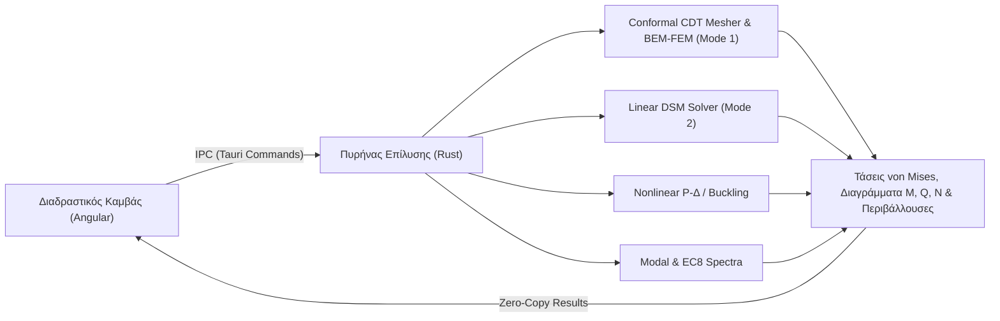

# OmniMechanics — Επιστημονική Τεκμηρίωση & Οδηγός

Καλώς ήρθατε στην επίσημη τεχνική και επιστημονική τεκμηρίωση του **OmniMechanics**.

Το **OmniMechanics** είναι ένα σύγχρονο λογισμικό υπολογιστικής μηχανικής για τη στατική, δυναμική και μη γραμμική ανάλυση **2D/3D Συνεχών Μέσων με Υβριδική Σύζευξη BEM-FEM (Mode 1)**, **Επιπέδων Πλαισιακών Φορέων (Mode 2)** και **Εκπαιδευτικής Μηχανικής (Mode 3)**, ανεπτυγμένο με **Rust core solver** και διαδραστικό **Angular frontend**.

---

## 🎯 Κύριοι Τομείς Τεκμηρίωσης

* **[Σχεδιαστής 2D Συνεχούς Μέσου & Πλέγμα CDT (Mode 1)](guide/continuum-sketcher.md)**:
  Αναλυτικός οδηγός για τη διαδραστική σχεδίαση πολυγωνικών περιγραμμάτων, οπών (cutouts), εγκλεισμάτων υλικού (inclusions), συνοριακών συνθηκών Dirichlet/Neumann/Robin και την παραγωγή 100% conformal πλέγματος (`Tri3`/`Quad4`, `Line2`/`Line3`).
* **[Οδηγός Χρήσης Πλαισιακών Φορέων (Mode 2)](guide/modeling.md)**:
  Αναλυτικό εγχειρίδιο για όλα τα εργαλεία σχεδίασης CAD, εργαλειοθήκες, γεωμετρικούς μετασχηματισμούς, επιθεωρητές ιδιοτήτων και πίνακα δυνάμεων άκρων.
* **[Φορτία, EC0 & EC8](guide/loads-and-combinations.md)**:
  Πλήρης επεξήγηση του ιδίου βάρους, των κατανεμημένων/τραπεζοειδών φορτίων, της αυτόματης παραγωγής συνδυασμών κατά **EN 1990 (EC0)** και των σεισμικών ρυθμίσεων **EN 1998 (EC8)**.
* **[Θεωρητικό Υπόβαθρο & Αλγόριθμοι](theory/analysis-methods.md)**:
  Συγκριτική ανάλυση και εσωτερική αριθμητική επίλυση των 6 μεθόδων ανάλυσης (1ης τάξης DSM, 2ης τάξης $P-\Delta$, λυγισμός Euler, ιδιομορφική ανάλυση, φασματική RSA, ισοδύναμη σεισμική ELF).
* **[Επαλήθευση & Benchmarks](benchmarks/validation.md)**:
  Συγκριτικοί έλεγχοι ακρίβειας έναντι του **OpenSees** και κλασικών κλειστών αναλυτικών λύσεων της βιβλιογραφίας.

---

## ⚡ Τεχνολογική Αρχιτεκτονική

> [!NOTE]
> Όλες οι αναλύσεις επιλύονται απευθείας σε εγγενή κώδικα Rust με χρήση της βιβλιοθήκης `nalgebra` και προηγμένων αριθμητικών μεθόδων (Cholesky, Generalized Symmetric Eigenvalues, Newton-Raphson).
