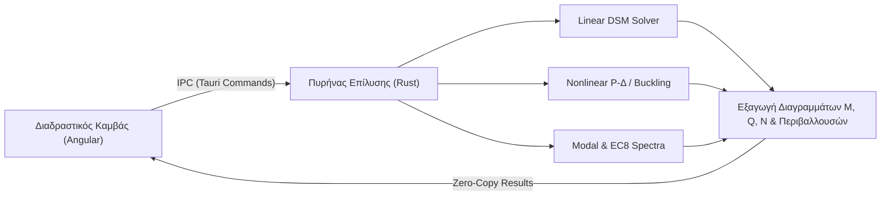

# OmniMechanics — Επιστημονική Τεκμηρίωση & Οδηγός

Καλώς ήρθατε στην επίσημη τεχνική και επιστημονική τεκμηρίωση του **OmniMechanics**.

Το **OmniMechanics** είναι ένα σύγχρονο λογισμικό στατικής, δυναμικής και μη γραμμικής ανάλυσης επιπέδων πλαισιακών φορέων (2D Frame Analysis), ανεπτυγμένο με **Rust core solver** και διαδραστικό **Angular frontend**.

---

## 🎯 Κύριοι Τομείς Τεκμηρίωσης

* **[Θεωρητικό Υπόβαθρο](theory/linear-dsm.md)**:
  Ανάλυση των μαθηματικών μητρώων δυσκαμψίας (DSM), μη γραμμικότητα 2ης τάξης $P-\Delta$, ελαστικός λυγισμός κατά Euler και θεωρία ελαστικής αλυσοειδούς Irvine για καλώδια.
* **[Ευρωκώδικες (Eurocodes)](eurocodes/en1990-combinations.md)**:
  Αυτόματη παραγωγή συνδυασμών δράσεων κατά **EN 1990 (EC0)** με το Ελληνικό Εθνικό Προσάρτημα, σεισμικό φάσμα σχεδιασμού και συνδυασμοί ιδιομορφών (CQC/SRSS) κατά **EN 1998 (EC8)**.
* **[Επαλήθευση & Benchmarks](benchmarks/validation.md)**:
  Συγκριτικοί έλεγχοι ακρίβειας έναντι του **OpenSees** και κλασικών κλειστών αναλυτικών λύσεων της βιβλιογραφίας.
* **[Οδηγός Χρήσης](guide/modeling.md)**:
  Οδηγίες για τη μοντελοποίηση, την εισαγωγή φορτίων, τη ρύθμιση στηρίξεων και την ανάγνωση των διαγραμμάτων και των περιβαλλουσών.

---

## ⚡ Τεχνολογική Αρχιτεκτονική

> [!NOTE]
> Όλες οι αναλύσεις επιλύονται απευθείας σε εγγενή κώδικα Rust με χρήση της βιβλιοθήκης `nalgebra` και προηγμένων αριθμητικών μεθόδων (Cholesky, Generalized Symmetric Eigenvalues, Newton-Raphson).
